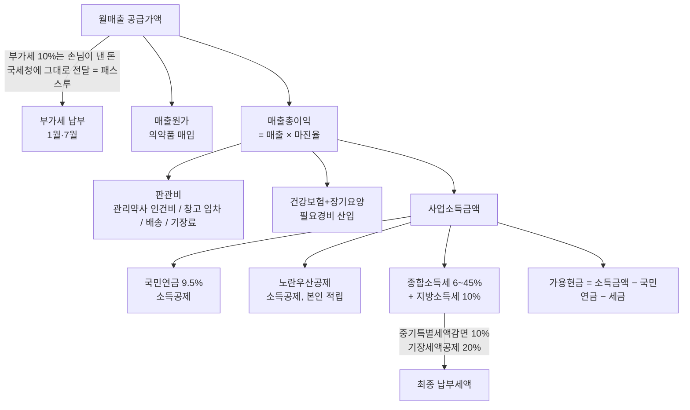
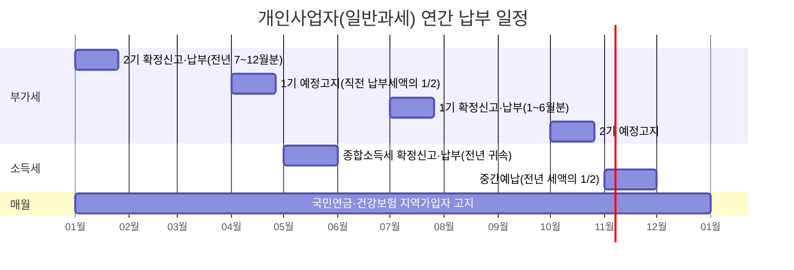

# 의약품 도매업 개인사업자 세금·가용현금 계산기 (2026 기준)

- 타임스탬프: 2026-10-14 03:51:53 UTC
- 유형: 조사 + 분석 + 구현
- 산출물: `tax_calc/pharma_tax_calc.py`, `tax_calc/scenarios_income_basis.json`
- 상태: v1 완료. 사용자 확인 필요 항목은 "미확정" 섹션.

## 1. 요약 (결론 먼저)

**"월매출 2천만"은 가용현금을 결정하는 변수가 아니다. 변수는 매출총이익(마진)이다.**

의약품 도매업의 업계 평균 유통마진은 약 7.5%다. 이 마진으로 월매출 2천만·3천만은
매출총이익이 월 150만·225만밖에 안 되고, 창고 임차·관리약사 인건비를 빼면 **적자**다.
세금은 0이고, 문제는 세금이 아니라 사업 구조다.

반대로 "2천만/3천만"이 **매출이 아니라 이미 손에 쥐는 이익**이라면 세금이 핵심이 된다.
그 경우 월 이익 2천만 → 세금·보험 떼고 월 약 1,300만, 월 이익 3천만 → 월 약 1,860만이 남는다.
실효 부담률(소득세+지방세, 소득금액 대비)은 26%→30%로 뛴다.

## 2. 돈의 흐름 (1st principles)



## 3. 제도 파라미터 (2026년, 검증일 2026-10-14)

| 항목 | 값 | 비고 |
|---|---|---|
| 종합소득세 세율 | 6/15/24/35/38/40/42/45% (1,400만/5,000만/8,800만/1.5억/3억/5억/10억) | 2023 개정 후 동일 |
| 지방소득세 | 소득세의 10% | |
| 국민연금 지역가입자 | 9.5% (2026.1~), 기준소득월액 상한 659만(2026.7~) → 최대 월 626,050원 | 매년 0.5%p 인상, 2033년 13% |
| 건강보험 지역가입자 | 소득의 7.19% + 장기요양(건보료의 13.14%) ≈ 소득의 8.13% | 재산 1억 공제 후 재산점수 별도, 자동차 부과 폐지 |
| 노란우산 소득공제 한도 | 소득 4천만↓ 600만 / 6천만↓ 500만 / 1억↓ 400만 / 1억↑ 200만 | 2025 납입분부터 |
| 중소기업특별세액감면 | 소기업 도매업 10% (수도권 무관) | 조특법 7조, 일몰 연장 여부 확인 필요 |
| 창업중소기업 세액감면 | **도매업은 대상 아님** | 조특법 6조 3항 업종 목록에 도소매 없음 |
| 기장 의무 (도매업) | 직전연도 매출 3억↑ 복식부기 의무, 6천만↑ 기준경비율 | 2.4억: 간편장부 대상 (복식부기 시 기장세액공제 20%, 한도 100만), 3.6억: 복식부기 의무 |
| 부가세 | 의약품 도매는 과세 10% (조제용역 면세는 약국 단계) | 일반과세자 |
| 약사법 요건 | 관리약사 필수(대표가 약사면 면제), 창고 264㎡ 기준 | 고정비의 핵심 |
| 업계 평균 유통마진 | 7.5% 안팎, 순이익률 1%대 | 한국의약품도매협회 자료, 다소 오래됨 |

## 4. 결과

### 4-A. "2천만/3천만 = 월매출" 해석 (대표가 약사, 고정비 월 250만, 관리약사 미고용)

| 항목 | 2,000만/7.5% | 2,000만/10% | 2,000만/15% | 2,000만/20% | 3,000만/7.5% | 3,000만/10% | 3,000만/15% | 3,000만/20% |
|---|---:|---:|---:|---:|---:|---:|---:|---:|
| 매출총이익(연) | 1,800만 | 2,400만 | 3,600만 | 4,800만 | 2,700만 | 3,600만 | 5,400만 | 7,200만 |
| 사업소득금액(연) | -1,227만 | -627만 | 555만 | 1,665만 | -327만 | 555만 | 2,219만 | 3,884만 |
| 소득세+지방세 | 0 | 0 | 0 | 25만 | 0 | 0 | 65만 | 276만 |
| **월 가용현금** | **-102만** | **-52만** | **42만** | **123만** | **-27만** | **42만** | **162만** | **270만** |

관리약사를 고용(월 450만)하면 모든 칸이 월 -150만 ~ -600만 적자.

### 4-B. "2천만/3천만 = 월 이익(매출총이익)" 해석

| 항목 | 월 이익 2,000만 (비용 0) | 월 이익 3,000만 (비용 0) | 2,000만 − 고정비 250만 | 3,000만 − 고정비 250만 | 2,000만 − 관리약사 고용 | 3,000만 − 관리약사 고용 |
|---|---:|---:|---:|---:|---:|---:|
| 사업소득금액(연) | 22,195만 | 33,292만 | 19,420만 | 30,517만 | 13,894만 | 24,991만 |
| 건강보험+장기요양(연) | 1,805만 | 2,708만 | 1,580만 | 2,483만 | 1,130만 | 2,033만 |
| 국민연금(연) | 751만 | 751만 | 751만 | 751만 | 751만 | 751만 |
| 소득세+지방세(연) | 5,841만 | 10,169만 | 4,798만 | 9,082만 | 2,784만 | 7,003만 |
| 실효세율(소득금액 대비) | 26.3% | 30.5% | 24.7% | 29.8% | 20.0% | 28.0% |
| **월 가용현금** | **1,300만** | **1,864만** | **1,156만** | **1,724만** | **863만** | **1,436만** |

읽는 법: 월 이익이 2천→3천만으로 50% 늘 때 가용현금은 1,300→1,864만으로 43%만 는다.
한계세율 구간이 38%(과세표준 1.5억↑)에서 40%(3억↑)로 넘어가기 때문이다.
노란우산공제는 이 소득대에선 한도 200만이라 세금 절감 월 7만 수준. 절세 효과보다 퇴직금 적립 기능이 본질.

### 4-C. 연간 현금 유출 캘린더



5월 종소세 + 11월 중간예납이 큰 덩어리다. 월 이익 3천만 케이스면 5월에 약 5천만, 11월에 약 5천만이 한 번에 나간다.
가용현금 1,864만/월은 "평균"이고, 실제로는 매달 세금 몫(약 850만)을 따로 쌓아둬야 한다.

## 5. 미확정 — 사용자가 채워야 할 입력값

정확도 순으로 영향이 큰 것부터.

| 우선순위 | 질문 | 왜 필요한가 | 계산기 파라미터 |
|---|---|---|---|
| 1 | 2천만/3천만은 **매출**인가 **이익**인가? | 결과가 적자 vs 월 1,300만으로 갈림 | `gross_margin` |
| 2 | 실제 **매출총이익률** (매입가 대비 판매가) | 업계 평균 7.5%는 대형 도매 기준, 특화 품목은 15~25%도 있음 | `gross_margin` |
| 3 | 대표가 **약사**인가? | 아니면 관리약사 고용 필수 → 연 6천만 고정비 | `owner_is_pharmacist`, `pharmacist_salary` |
| 4 | 창고·사무실 **임차료**, 배송 방식(자차/위탁) | 고정비 | `rent`, `vehicle`, `misc` |
| 5 | **부양가족** 수, 배우자 소득 유무 | 인적공제 150만/인, 건보 피부양 여부 | `dependents` |
| 6 | 본인 명의 **재산**(부동산 과세표준) | 건보 재산보험료 (1억 공제 후) | `hi_property_points` |
| 7 | 사업장 **소재지** (수도권 과밀억제권역 여부) | 중기특별감면은 도매업 10%로 동일하나, 다른 감면·지방세 영향 | `sme_reduction` |
| 8 | **창업 시점**, 직전연도 매출 | 기장 의무(간편장부/복식부기), 기준경비율 vs 장부 | `double_entry` |
| 9 | 거래처 **결제 조건**(외상 기간) | 이익이 나도 현금이 거래처에 묶임 (업계 고질) | 미구현 |
| 10 | 향후 **법인 전환** 검토 여부 | 과세표준 1억↑이면 법인(9~19%) + 급여 설계가 유리해지기 시작 | 미구현 |

## 6. 모델 가정 (명시)

- 월매출은 **공급가액**(부가세 별도). 매입은 전액 과세매입으로 보고 부가세는 패스스루 처리.
- 건강보험료는 **필요경비**, 국민연금은 **소득공제** (현행 소득세법 취급). 둘 다 소득금액에 종속되므로 고정점 반복으로 수렴시킴.
- 건보료는 실제로는 전년도 소득 기준으로 부과되나, 정상상태(steady-state)로 당해연도 소득에 적용.
- 노란우산은 한도까지 납입 가정. 납입액은 본인 자산이므로 "가용현금"에선 빼지 않고 별도 행으로 표시.
- 세액공제: 표준세액공제 7만 + 전자신고 2만. 기장세액공제는 연매출 3억 미만 + 복식부기 시만 적용.
- 중소기업특별세액감면 10% 적용 (일몰·개편 여부는 매년 재확인).
- 의료비·교육비·보험료·기부금 세액공제, 신용카드 공제(사업자 불가) 등 개인별 항목 미반영.
- 운영비(임차료 등)에 붙은 매입세액은 보수적으로 공제 반영 안 함 → 부가세 납부액은 실제보다 약간 과대.

## 7. 사용법

```bash
cd tax_calc
python3 pharma_tax_calc.py                       # 기본: 2천/3천만 × 마진 7.5/10/15/20%
python3 pharma_tax_calc.py --pharmacist          # 대표가 약사
python3 pharma_tax_calc.py --sales 25000000 --margin 0.12 --pharmacist --dependents 2
python3 pharma_tax_calc.py --scenarios scenarios_income_basis.json
python3 pharma_tax_calc.py --json                # 기계가독 출력
```

## 8. 다음 행동

1. 사용자: 5번 표의 1~4번 답변 → 즉시 재계산.
2. 결제 조건(외상)을 반영한 **월별 현금흐름 시뮬레이터** 추가 (이익≠현금 문제).
3. 과세표준 1억 초과 구간에서 **개인 vs 법인(급여+배당)** 비교 모듈.
4. 매년 1월: PARAMS 갱신 (국민연금 요율 +0.5%p, 건보 요율, 감면 일몰).

## 9. 출처

- 건강보험료율 7.19%, 장기요양 13.14%: [jab-guyver 2026 계산기](https://jab-guyver.co.kr/7133), [wikidocs 장기요양](https://wikidocs.net/blog/@Insight_Lab/29378/), [studygov](https://studygov.kr/blog/0422-health-insurance-premium-2026/)
- 국민연금 9.5%, 상한 659만: [쿠키뉴스](https://www.kukinews.com/article/view/kuk202601120010), [bizforms](https://www.bizforms.co.kr/smartblock/jul2026_npscap.asp), [wikidocs](https://wikidocs.net/blog/@openwiki/21195/)
- 종합소득세 세율표: [moneynestlab](https://www.moneynestlab.com/comprehensive-income-tax/guide/tax-rate-table), [wikidocs](https://wikidocs.net/blog/@Insight_Lab/22783/), [thecheck](https://thecheck.co.kr/%EC%A2%85%ED%95%A9%EC%86%8C%EB%93%9D%EC%84%B8-%EA%B3%BC%EC%84%B8%ED%91%9C%EC%A4%80-%EA%B5%AC%EA%B0%84-2026-%EC%A2%85%EC%86%8C%EC%84%B8-%EC%8B%A0%EA%B3%A0-%EC%84%B8%EC%9C%A8-%EC%A0%95%EB%A6%AC/)
- 노란우산 한도 600/500/400/200만: [wikidocs](https://wikidocs.net/blog/@Insight_Lab/22095/), [save-tax](https://www.save-tax.co.kr/blog/%EB%85%B8%EB%9E%80%EC%9A%B0%EC%82%B0%EA%B3%B5%EC%A0%9C-%EA%B0%80%EC%9E%85%ED%95%98%EB%A9%B4-%EC%B5%9C%EB%8C%80-600%EB%A7%8C-%EC%9B%90%EA%B9%8C%EC%A7%80-%EC%86%8C%EB%93%9D%EA%B3%B5%EC%A0%9C-%EB%B0%9B), [glasswallet](https://glasswallet.com/blog/noranwoosan-deduction-limit-guide)
- 창업중소기업 감면에 도매업 미포함: [bznav](https://ai.bznav.com/contents/3217504), [taxly 17485](https://taxly.kr/qna/17485-청년창업세액감면-도소매)
- 기장 의무 기준(도매 3억/6천만): [sootax](https://sootax.co.kr/3509), [save-tax](https://www.save-tax.co.kr/blog/복식부기-vs-간편장부-기준경비율-vs-단순경비율-판정), [wikidocs](https://wikidocs.net/blog/@Insight_Lab/28111/)
- 의약품 도매 유통마진 7.5%: [데일리팜 274988](https://www.dailypharm.com/user/news/274988), [데일리팜 252528](https://www.dailypharm.com/user/news/252528), [데일리팜 172298](https://www.dailypharm.com/user/news/172298)
- 관리약사·창고 264㎡: [데일리팜 140066](https://www.dailypharm.com/user/news/140066), [guard1004](https://www.guard1004.com/m/589)
- 약국 조제 면세/일반약 과세: [heumtax](https://www.heumtax.com/contents/posts/pharmacy-tax-study-material), [데일리팜 20879](https://m.dailypharm.com/user/news/20879)
