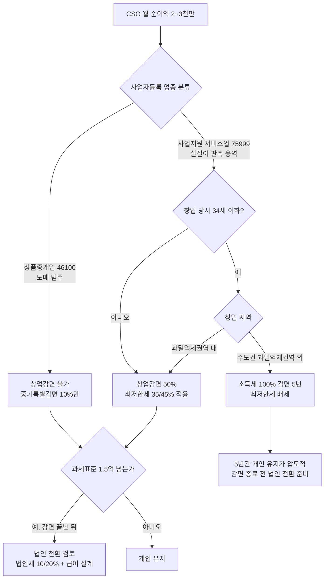

# CSO(의약품 판촉영업자) 순이익 2천/3천만 기준 가용현금 — 개인 vs 법인

- 타임스탬프: 20261014_040438 UTC
- 유형: 수정 + 분석 + 구현
- 선행 기록: 20261014_035153 (의약품 도매 가정) → 사용자 정정: **2천/3천만은 순이익, 업종은 CSO**
- 산출물: `tax_calc/cso_net_cash.py` (pharma_tax_calc.py 의 제도값·함수 재사용)

## 1. 요약

같은 월 순이익이라도 **어떤 상자에 체크하느냐**(업종 분류·감면·사업 형태)로 월 가용현금이 2천만 기준 1,236만~1,787만, 3천만 기준 1,770만~2,712만까지 벌어진다. 세율표보다 이 선택이 훨씬 큰 레버다.

| 월 순이익 | 개인·감면 없음 | 개인·중기 10% | 개인·창업 50% | 개인·청년창업 100% | 법인(급여 500만, 유보 포함) |
|---|---:|---:|---:|---:|---:|
| 2,000만 | **1,236만** | 1,291만 | 1,512만 | **1,787만** | 1,698만 (개인 411 + 유보 1,288) |
| 3,000만 | **1,770만** | 1,864만 | 2,241만 | **2,712만** | 2,502만 (개인 411 + 유보 2,092) |

## 2. 의사결정 트리



## 3. 개인사업자 상세 (부양가족 0, 노란우산 한도 납입, 재산 0)

## 개인사업자

| 항목 | 2,000만 / 감면 없음(상품중개업 등) | 2,000만 / 중기특별감면 10% | 2,000만 / 창업감면 50%(최저한세 적용) | 2,000만 / 창업감면 75%(2026 개편안) | 2,000만 / 청년창업감면 100%(비수도권) | 3,000만 / 감면 없음(상품중개업 등) | 3,000만 / 중기특별감면 10% | 3,000만 / 창업감면 50%(최저한세 적용) | 3,000만 / 창업감면 75%(2026 개편안) | 3,000만 / 청년창업감면 100%(비수도권) |
|---|---:|---:|---:|---:|---:|---:|---:|---:|---:|---:|
| 연 순이익(입력) | 24,000만 | 24,000만 | 24,000만 | 24,000만 | 24,000만 | 36,000만 | 36,000만 | 36,000만 | 36,000만 | 36,000만 |
| 건강보험+장기요양(필요경비) | 1,805만 | 1,805만 | 1,805만 | 1,805만 | 1,805만 | 2,708만 | 2,708만 | 2,708만 | 2,708만 | 2,708만 |
| = 사업소득금액 | 22,195만 | 22,195만 | 22,195만 | 22,195만 | 22,195만 | 33,292만 | 33,292만 | 33,292만 | 33,292만 | 33,292만 |
| 국민연금(소득공제) | 751만 | 751만 | 751만 | 751만 | 751만 | 751만 | 751만 | 751만 | 751만 | 751만 |
| 노란우산(소득공제) | 200만 | 200만 | 200만 | 200만 | 200만 | 200만 | 200만 | 200만 | 200만 | 200만 |
| 과세표준 | 21,093만 | 21,093만 | 21,093만 | 21,093만 | 21,093만 | 32,191만 | 32,191만 | 32,191만 | 32,191만 | 32,191만 |
| 산출세액 | 6,021만 | 6,021만 | 6,021만 | 6,021만 | 6,021만 | 10,282만 | 10,282만 | 10,282만 | 10,282만 | 10,282만 |
| 감면액(최저한세 반영) | 0만 | 602만 | 3,011만 | 3,612만 | 6,021만 | 0만 | 1,028만 | 5,141만 | 5,955만 | 10,282만 |
| 소득세+지방세 | 6,614만 | 5,951만 | 3,302만 | 2,641만 | 0만 | 11,301만 | 10,169만 | 5,645만 | 4,750만 | 0만 |
| = 연 가용현금 | 14,830만 | 15,492만 | 18,141만 | 18,803만 | 21,443만 | 21,240만 | 22,371만 | 26,895만 | 27,791만 | 32,541만 |
| = 월 가용현금 | 1,236만 | 1,291만 | 1,512만 | 1,567만 | 1,787만 | 1,770만 | 1,864만 | 2,241만 | 2,316만 | 2,712만 |
| 실효부담률(소득금액 대비) | 29.8% | 26.8% | 14.9% | 11.9% | 0.0% | 33.9% | 30.5% | 17.0% | 14.3% | 0.0% |

읽는 법
- 소득세 0원이어도 건강보험(연 1,805만/2,708만)과 국민연금(연 751만, 상한)은 그대로 나간다. 100% 감면 케이스의 실효부담은 세금 0이지만 사회보험이 소득의 약 11%.
- 노란우산은 이 소득대에서 공제 한도 200만 → 세금 효과 월 6~7만. 절세 수단이 아니라 퇴직금 적립 수단으로 봐야 한다.
- 창업감면 50%는 최저한세(산출세액 3천만 이하 35%, 초과분 45%)에 걸려 실제 감면이 50%에 못 미칠 수 있다. 위 표는 최저한세를 반영한 값.

## 4. 법인 + 대표 급여 비교

| 항목 | 2,000만 / 급여 500만 / 유보 | 2,000만 / 급여 500만 / 전액배당 | 2,000만 / 급여 1,000만 / 유보 | 2,000만 / 급여 1,000만 / 전액배당 | 3,000만 / 급여 500만 / 유보 | 3,000만 / 급여 500만 / 전액배당 | 3,000만 / 급여 1,000만 / 유보 | 3,000만 / 급여 1,000만 / 전액배당 |
|---|---:|---:|---:|---:|---:|---:|---:|---:|
| 연 순이익(급여 전) | 24,000만 | 24,000만 | 24,000만 | 24,000만 | 36,000만 | 36,000만 | 36,000만 | 36,000만 |
| 대표 급여(연) | 6,000만 | 6,000만 | 12,000만 | 12,000만 | 6,000만 | 6,000만 | 12,000만 | 12,000만 |
| 법인 부담 4대보험 | 640만 | 640만 | 1,086만 | 1,086만 | 640만 | 640만 | 1,086만 | 1,086만 |
| 법인 과세표준 | 17,360만 | 17,360만 | 10,914만 | 10,914만 | 29,360만 | 29,360만 | 22,914만 | 22,914만 |
| 법인세+지방세 | 1,910만 | 1,910만 | 1,201만 | 1,201만 | 4,259만 | 4,259만 | 2,841만 | 2,841만 |
| 법인 세후 유보 | 15,450만 | 15,450만 | 9,714만 | 9,714만 | 25,101만 | 25,101만 | 20,073만 | 20,073만 |
| 본인 부담 4대보험 | 583만 | 583만 | 972만 | 972만 | 583만 | 583만 | 972만 | 972만 |
| 근로소득세+지방세 | 489만 | 489만 | 2,073만 | 2,073만 | 489만 | 489만 | 2,073만 | 2,073만 |
| 급여 실수령(연) | 4,928만 | 4,928만 | 8,955만 | 8,955만 | 4,928만 | 4,928만 | 8,955만 | 8,955만 |
| 배당 실수령(연) | 0만 | 13,071만 | 0만 | 8,218만 | 0만 | 21,235만 | 0만 | 16,982만 |
| = 월 개인 현금 | 411만 | 1,500만 | 746만 | 1,431만 | 411만 | 2,180만 | 746만 | 2,161만 |
| = 월 법인 유보 | 1,288만 | 0만 | 809만 | 0만 | 2,092만 | 0만 | 1,673만 | 0만 |
| = 월 합계(개인+유보) | 1,698만 | 1,500만 | 1,556만 | 1,431만 | 2,502만 | 2,180만 | 2,419만 | 2,161만 |

읽는 법
- 법인 "유보"는 회사 돈이다. 개인 통장이 아니다. 꺼내려면 급여(근로소득세)나 배당(15.4%, 연 2천만 초과분은 종합과세 합산)을 거친다.
- "전액배당" 열은 배당 1억 넘는 상황이라 실제로는 금융소득종합과세로 15.4%보다 더 나온다. 상한선이 아니라 하한선으로 읽을 것.
- 그래서 법인이 유리한 조건은 **당장 다 쓰지 않고 회사에 쌓아 재투자/퇴직금(임원퇴직금 한도)로 꺼낼 계획이 있을 때**다. 매달 전부 생활비로 써야 하면 개인+감면이 낫다.
- 법인세율은 2026 사업연도부터 10%/20%로 1%p 인상된 값을 적용했다.

## 5. CSO 업종 고유 체크리스트 (세금 외 현금에 영향)

| 항목 | 내용 | 현금 영향 |
|---|---|---|
| 신고제 | 2024.10.19~ 관할 지자체에 의약품 판촉영업자 신고. 미신고자에게 제약사가 위탁 불가 | 미신고 시 매출 자체가 불가 |
| 교육 | 신고 전 24시간 신규교육, 매년 8시간 보수교육 | 교육비·시간 |
| 지출보고서 | 경제적 이익 제공 내역 작성·심평원 제출·공개 대상 | 판촉비 증빙 없으면 비용 부인 → 소득 증가 |
| 리베이트 쌍벌제 | 허용 범위 밖 경제적 이익 제공 시 형사·행정 처분 | 사업 존속 리스크 |
| 접대비 한도 | 개인 중소기업 기본 3,600만 + 수입금액×0.3% | 초과분은 비용 불인정 |
| 부가세 | 수수료는 과세 용역 10%. 세금계산서 발행, 제약사가 부가세 얹어 지급 | 패스스루, 1월·7월 납부 |
| 기장 의무 | 서비스업: 직전연도 수수료 매출 7,500만↑ 복식부기, 5억↑ 성실신고확인 | 기장료 연 100~200만 |
| 수수료율 | 국감 기준 CSO 평균 수수료율 43% → 월 순이익 3천만이면 수수료 매출은 그보다 훨씬 큼 | 매출이 커서 성실신고 5억 기준 접근 가능 |

## 6. 미확정 — 사용자 입력 필요

| 우선순위 | 질문 | 왜 |
|---|---|---|
| 1 | 창업 당시 나이(34세 이하?), 사업장 소재지(수도권 과밀억제권역 여부), 창업 예정일 | 창업감면 0/50/75/100% 결정. 월 500만 차이 |
| 2 | 사업자등록 시 업종을 '사업지원 서비스업'으로 잡을 수 있는 실질이 있는가(계약서상 용역 내용) | 창업감면 적용 가능 여부. 세무사 확인 필수 |
| 3 | 월 순이익 2~3천만을 **전부 생활비로 쓰는가**, 일부 유보 가능한가 | 개인 vs 법인 결정 |
| 4 | 수수료 매출 규모(순이익 아님) | 기장·성실신고·부가세 규모 |
| 5 | 부양가족, 배우자 소득, 본인 명의 부동산 | 인적공제·건보 재산보험료 |

## 7. 모델 가정

- 순이익 = 수수료 매출 − 사업경비(판촉·차량·통신·기장료 등). 본인 건보·연금·소득세 차감 전.
- 건보료 필요경비 산입, 국민연금 소득공제. 고정점 반복으로 수렴.
- 창업감면과 중기특별감면은 중복 불가. 창업감면·중기감면 모두 농특세 비과세로 처리.
- 법인: 대표 1인, 직장가입자 보험료(본인·회사 각 4.75%/3.595%+장기요양, 고용 0.9%/1.15%, 산재 0.7%), 근로소득공제·근로소득세액공제 반영. 표준세액공제는 보수적으로 7만.
- 배당은 15.4% 분리과세로 단순화 (연 2천만 초과 시 실제는 더 큼).
- 2026.1.1 이후 창업분 감면율 개편(75%) 보도는 미확정 → 별도 열로 병기.

## 8. 사용법

```bash
cd tax_calc
python3 cso_net_cash.py                                   # 2천/3천만 × 감면 5종, 법인 급여 500/1000만
python3 cso_net_cash.py --profit 25000000 --regimes none startup100 --salary 7000000 --dependents 2
python3 cso_net_cash.py --json
```

## 9. 다음 행동

1. 사용자: 6번 표 1~3번 답변 → 단일 추천안으로 압축.
2. 법인 케이스에 임원퇴직금 한도(퇴직 전 3년 평균급여 × 1/10 × 근속연수 × 2배) 인출 경로 추가.
3. 창업감면 종료(6년차) 시점의 개인→법인 전환 타이밍 시뮬레이션.
4. 조특법 6조 2026 개정 조문 확정되면 `REGIMES` 갱신.

## 10. 출처

- CSO 신고제·교육·지출보고서: [법률신문](https://www.lawtimes.co.kr/news/206328), [데일리팜 10대뉴스](https://dailypharm.com/user/news/10005), [데일리팜 24시간 교육](https://m.dailypharm.com/newsView.html?ID=313736), [데일리팜 코프로모션](https://dailypharm.com/user/news/15014)
- CSO 수수료율 평균 43%: [데일리팜 국감](https://dailypharm.com/user/news/343186)
- 창업감면 업종·나이·지역, 코드만으로 판단 불가: [국세청 창업중소기업 안내](https://www.nts.go.kr/nts/cm/cntnts/cntntsView.do?mi=6553&cntntsId=7979), [findsemusa 14603](https://www.findsemusa.com/service/consult/consultView.do?qidx=14603), [taxly 140415](https://taxly.kr/qna/140415-%EC%B2%AD%EB%85%84%EC%B0%BD%EC%97%85%EC%84%B8%EC%95%A1%EA%B0%90%EB%A9%B4-%EC%97%85%EC%A2%85%EC%BD%94%EB%93%9C%EC%97%90-%EB%8C%80%ED%95%9C-%EB%AC%B8%EC%9D%98%EC%9E%85%EB%8B%88%EB%8B%A4), [oddoffice](https://www.oddoffice.co.kr/blog/?bmode=view&idx=16061631)
- 최저한세와 100% 감면 배제: [taxly 135837](https://taxly.kr/qna/135837-청년-창업-기업-최저한세-적용-문의), [sootax](https://sootax.co.kr/5694), [taxnet 2025 중소기업세제](https://file.taxnet.co.kr/taxnetfile/public_data/2025%20중소기업세제·세정지원%20제도_3237829.pdf)
- 서비스업 복식부기 7,500만·성실신고 5억: [glasswallet](https://glasswallet.com/blog/double-entry-bookkeeping-obligation-guide), [thecheck](https://thecheck.co.kr/?p=3472), [bznav](https://help.bznav.com/hc/ko/articles/900006654066)
- 법인세율 2026 10/20%: [taxfirm](https://taxfirm.co.kr/blog/corporate-tax-rate-2026-guide), [taxguide](https://taxguide.im/blog/corptax-rate), [taxnet](https://www.taxnet.co.kr/contents/taxnetpost/post-detail?id=4653)
- 공통 제도값(소득세율·연금·건보·노란우산)은 선행 기록 20261014_035153 출처 참조
