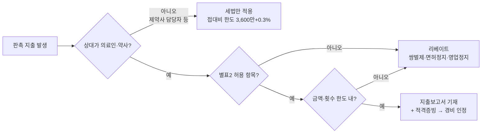
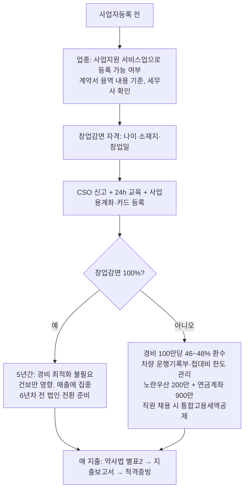

# CSO 개인사업자 — 쓸 수 있는 영업비용, 소득공제, 세액공제·감면 가이드 (2026)

- 타임스탬프: 20261014_040834 UTC
- 유형: 조사 + 분석
- 선행 기록: 20261014 CSO 순이익 기준 가용현금 (월 순이익 2천/3천만, 감면 없음 기준 한계세율 41.8%~44%)
- 상태: v1. 약사법 허용 범위 수치는 공정경쟁규약·시행규칙 별표2 원문 재확인 필요(섹션 8)

## 1. 요약 — 각 항목이 당신 소득대에서 실제로 얼마짜리인가

세율표가 아니라 **한계부담률**(1만원 더 벌면 얼마 뜯기나)로 봐야 한다. 월 순이익 2~3천만이면 과세표준 2.1억~3.2억, 한계세율 38~40% + 지방소득세 + 건강보험 8.13%.

| 행동 | 2,000만/월 | 3,000만/월 | 비고 |
|---|---:|---:|---|
| 사업경비 100만 지출(적격증빙) | 46.2만 돌아옴 | 48.2만 돌아옴 | 실제 현금부담은 54만/52만 |
| 같은 경비, **청년창업감면 100%** 적용 중 | 7.5만 | 7.5만 | 소득세 0이라 건보만 줄어듦 |
| 부양가족 1명 기본공제(150만) | 62.7만 | 66.0만 | 소득 100만 이하 가족 |
| 노란우산 200만 납입 | 83.6만 | 88.0만 | 이 소득대 한도 200만 |
| 연금저축+IRP 900만 납입 | 118.8만 | 118.8만 | 13.2% 세액공제, 연금수령 시 3.3~5.5% 과세 |
| 직원 1명 채용(통합고용세액공제) | 850~1,550만 × 3년 | 동일 | 청년·수도권 외일수록 큼 |

**원칙 1.** 감면 없이 개인으로 가면, 어차피 쓸 돈은 전부 사업경비로 돌려라. 돌아오는 비율이 46~48%다.
**원칙 2.** 청년창업감면 100%를 받는 5년간은 영수증 모으기에 시간 쓰지 마라. 건보 8%밖에 안 줄어든다. 그 시간에 매출을 키워라.
**원칙 3.** CSO의 판촉비는 세법 한도보다 **약사법 리베이트 규정이 먼저** 걸린다. 세무서보다 복지부가 무섭다.

## 2. 필요경비 — CSO 영업비용 항목별 한도와 증빙

| 계정 | CSO에서의 실제 내용 | 세법 한도·조건 | 약사법 제약 | 증빙 |
|---|---|---|---|---|
| **기업업무추진비**(구 접대비) | 거래처(약국·병원·제약사 담당자) 식사·선물·경조사 | 연 3,600만 + 수입금액×0.3% (중소기업). 건당 3만원 초과는 적격증빙 필수. 경조사비는 건당 20만원까지 청첩장·부고로 대체 가능 | **의료인·약사에게는 원칙 금지.** 허용 범위(섹션 3) 밖이면 쌍벌제. 제약사 직원 접대는 세법만 적용 | 카드·세금계산서, 경조사는 초대장 |
| **판촉비 / 광고선전비** | 제품설명회 식음료, 학술자료 인쇄, 견본품 배송 | 한도 없음. 특정인 대상이면 접대비로 재분류될 수 있음 | 제품설명회 식음료 1인 10만원 이내 등 별표2 범위. **전건 지출보고서 기재** | 참석자 명단 + 영수증 |
| **차량비** | 거래처 순회 (CSO 최대 경비) | 복식부기의무자(직전 매출 7,500만↑): 운행기록부 없으면 연 1,500만 한도(감가상각 800만 포함). 운행기록부 쓰면 업무사용비율만큼. 2대째부터 업무전용 자동차보험 의무, 미가입 시 전액 부인. 경차·9인승↑·화물차는 한도 없음 | 없음 | 운행기록부(홈택스 서식), 주유·통행료·보험·수리 카드 |
| **여비교통비** | 지방 출장 KTX·숙박·주차 | 실비, 업무관련성 | 의료인 교통·숙박 대신 지급 시 별표2 범위 | 카드, 출장 일정 |
| **인건비** | 직원·가족 급여 | 전액. 가족도 실제 근무 + 급여신고 + 4대보험이면 인정. 사업주 부담 4대보험도 경비 | 직원도 24h 신규교육·8h 보수교육 이수 필수 | 급여대장, 원천세 신고 |
| **지급수수료** | 하위 CSO(재위탁) 수수료, 세무기장료, 플랫폼 이용료 | 전액. 재위탁 대상이 **신고된 CSO**여야 함. 개인에게 지급 시 3.3% 원천징수 | 미신고 CSO에 재위탁 시 처분 | 세금계산서 또는 원천징수영수증 |
| **임차료** | 사무실·공유오피스 | 전액. 자택 겸용은 업무 사용 면적 비율 | 신고 시 사업장 소재지 필요 | 세금계산서, 임대차계약 |
| **통신비** | 휴대폰·인터넷 | 사업용 회선 전액, 겸용은 비율 | | 사업자 명의 청구서 |
| **교육훈련비** | CSO 법정교육(24h/8h), 영업·의약 교육 | 전액 | 교육 미이수 시 영업정지 | 수료증, 영수증 |
| **협회비·도서** | 관련 협회 회비, 의약 학술지 | 전액 | | |
| **보험료** | 사업용 차량보험, 배상책임보험 | 전액. 본인 건강보험·장기요양도 필요경비 | | |
| **감가상각비** | 노트북·태블릿·차량 | 정액/정률. 소액(100만 미만)은 즉시 비용 | | 세금계산서 |
| **이자비용** | 사업용 대출 이자 | 사업용 차입만. 초과인출금 이자는 부인 | | 대출계약서 |
| **소모품·복리후생** | 사무용품, 직원 식대·경조 | 직원 경조는 복리후생비(한도 없음), 거래처 경조는 접대비 | | |
| **세금과공과** | 사업소득세 ✗, 자동차세·면허세 ○, 가산세 ✗ | | | |

공통 규칙
- 복식부기의무자는 **사업용 계좌**를 신고·사용해야 하고, 미사용 시 거래금액의 0.2% 가산세.
- 홈택스에 **사업용 신용카드**를 등록하면 매입세액·경비가 자동 집계된다. 개인카드와 섞지 마라.
- 적격증빙(세금계산서·계산서·현금영수증·카드) 없는 3만원 초과 지출은 경비는 되지만 **2% 증빙불비 가산세**.
- 현금 지급 판촉비는 세법상 경비도 안 되고 약사법상 리베이트 추정이다. 하지 마라.

## 3. 약사법이 허용하는 경제적 이익 (판촉비의 법적 울타리)

약사법 47조 2항 + 시행규칙 별표2 + 공정경쟁규약. CSO도 2024.10.19부터 동일 적용, 전건 **지출보고서** 작성 후 심평원 제출·공개.

| 허용 항목 | 범위(규약·보도 기준, 원문 재확인) | 세무 처리 |
|---|---|---|
| 견본품 | 최소 포장단위, "견본품" 표시 | 판촉비 |
| 제품설명회 | 식음료 1인 10만원 이내(세금·봉사료 제외), 교통·숙박 실비. 개별 요양기관 방문 설명회는 월 4회 한도 | 판촉비, 참석자 명단 보관 |
| 학술대회 지원 | 주최 학회·기관을 통해서만. 개인 의료인 직접 지원 불가 | 광고선전비 |
| 임상시험·시판후조사(PMS) | 계약서 기반, 증례당 사례비 상한 | 지급수수료 |
| 강연료·자문료 | 1회 50만원, 연 300만원 이내, 강연은 10인 이상 청중 (공정경쟁규약) | 기타소득 원천징수 8.8% |
| 기념품 | 소액(규약 기준 5만원 이하 보도), 상품권 불가 | 판촉비 |
| 경조사비 | 의료인 대상은 규약상 10만원 이내 보도, 사실상 비권장 | 접대비 |
| 대금결제 할인 | 도매·제약 전용. CSO 해당 없음 | — |

금지: 현금, 상품권, 골프, 향응, 특수관계 의료기관·약국 판촉(2024 개정으로 명시 금지).

## 4. 소득공제 — 사업소득자가 받는 것과 못 받는 것

| 공제 | 사업소득자 | 금액 |
|---|---|---|
| 기본공제(본인·배우자·부양가족) | ○ | 1인 150만, 가족 소득 100만 이하 |
| 추가공제 | ○ | 경로(70세↑) 100만, 장애인 200만, 부녀자 50만, 한부모 100만 |
| 국민연금 보험료 | ○ | 전액 (지역가입자 상한 월 626,050원) |
| 노란우산공제 | ○ | 소득금액 1억 초과 시 200만 (4천만↓ 600만) |
| 벤처투자·엔젤투자 소득공제 | ○ | 3천만 이하 100%, 5천만 이하 70%, 초과 30%. 종합소득금액 50% 한도 |
| 신용카드 사용 소득공제 | **✗** | 근로소득 전용 |
| 주택청약·주택자금(주담대 이자, 전세 원리금) | **✗** | 근로소득 전용 |
| 보험료·의료비·교육비 소득공제 | **✗** | 근로소득 전용. 성실사업자는 세액공제로 일부 가능(섹션 5) |
| 건강보험료 | 소득공제 아님 → **필요경비** | 이미 경비 처리 |

## 5. 세액공제·세액감면 — 사업소득자

| 항목 | 조건 | 효과 (월 순이익 2~3천만 기준) |
|---|---|---|
| **창업중소기업 세액감면** | 조특법 6조 열거 업종(사업지원 서비스업 ○, 상품중개업 ✗), 창업 후 5년, 청년(34세↓)·수도권 외 100%, 그 외 50% (2026 창업분 75% 개편 보도) | 연 6,600만~1.1억 (100% 시) |
| **중소기업특별세액감면** | 조특법 7조 업종(도소매 10%). 창업감면과 중복 불가 | 연 600만~1,000만 |
| **통합고용세액공제** | 상시근로자 증가 1인당 중소 850만(수도권)/950만(지방), 청년·경력단절 등 1,450만/1,550만, 3년간. 고용 유지 조건 | 1인 채용 시 3년 2,550만~4,650만 |
| **연금계좌 세액공제** | 연금저축 600만 + IRP 합산 900만. 종합소득 4,500만 초과 13.2% | 118.8만 |
| **자녀세액공제** | 8세 이상 자녀 1명 25만, 2명 55만, 3명 95만. 출산·입양 첫째 30·둘째 50·셋째 70만 | |
| **기부금** | 사업소득만 있으면 **필요경비 산입**(세액공제 아님). 정치자금 10만원까지 100/110 세액공제 | 경비와 동일 효과 |
| **기장세액공제** | 간편장부대상자(직전 매출 7,500만 미만)가 복식부기로 신고, 산출세액 20%, 한도 100만 | 초기 1~2년만 해당 |
| **표준세액공제 + 전자신고** | 자동 | 7만 + 2만 |
| **성실신고확인비용 세액공제** | 직전 매출 5억 이상 성실신고확인대상자, 확인비용 60%, 한도 120만 | 수수료 매출 5억 넘으면 |
| **성실사업자 의료비·교육비·월세 세액공제** | 조특법 122조의3. 복식부기 + 사업용계좌 + 현금영수증가맹 + 수입금액 급증 없음 등 | 의료비·교육비 15% |
| 통합투자세액공제 | 사업용 유형자산(차량 제외) 중소 10% | 설비 투자 시 |
| 전자세금계산서 발급 세액공제 | 직전 매출 3억 미만, 건당 200원, 연 100만 한도 (부가세) | 소액 |
| 현금영수증 발급 세액공제 | 소비자 상대 업종 전용 | CSO ✗ |

## 6. 부가가치세 매입세액 — 돌려받는 것과 못 받는 것

| 지출 | 매입세액 공제 |
|---|---|
| 사무실 임차료, 통신, 기장료, 노트북, 광고 | ○ |
| 1,000cc 초과 승용차 구입·리스·유류·수리 | **✗** (경비는 되나 부가세는 불공제) |
| 경차, 9인승 이상, 화물차 | ○ |
| 접대비(거래처 식사·선물) | **✗** |
| 면세 매입(도서, 의료용역) | ✗ (부가세 자체가 없음) |
| 직원 식대·복리후생 | ○ |

수수료 매출 10%를 제약사에서 받아 납부하는 구조라, 공제 가능한 매입세액이 적을수록 1월·7월 납부액이 그대로 매출의 10%에 수렴한다.

## 7. 실행 순서

## 8. 미확정 — 원문 확인 필요

| 항목 | 상태 |
|---|---|
| 제품설명회 식음료 10만원·월 4회, 기념품 5만원, 경조사비 10만원 | 공정경쟁규약·보도 기반. 시행규칙 별표2 현행 원문으로 확인 |
| 강연료·자문료 1회 50만·연 300만 | 2018년 규약 보도 기반. 현행 규약 확인 |
| 2026 창업분 창업감면율 75% 개편 | 보도만 존재. 조특법 6조 개정 조문 확인 |
| 업무전용 자동차보험 2026년 1대부터 의무화 여부 | 블로그 상충. 소득세법 시행령 78조의3 확인 |
| 통합고용세액공제 2026 금액 | 2025 기준값 사용. 개정 여부 확인 |
| 접대비 3,600만 + 0.3% | 소득세법 35조 기준, 2026 유지로 가정 |

## 9. 다음 행동

1. 사용자: 창업감면 자격(나이·소재지·업종 실질) 확정 → 원칙 1/2 중 택일.
2. `cso_net_cash.py`에 경비 항목별 입력(차량·접대비·연금계좌·직원 수)을 추가해 "경비 반영 후 가용현금" 열 생성.
3. 섹션 8 원문 확인 후 수치 고정.

## 10. 출처

- 업무용승용차 1,500만·800만·업무전용보험: [bznav 2987770](https://ai.bznav.com/contents/2987770), [bznav 3025921](https://ai.bznav.com/contents/3025921), [wikidocs 26620](https://wikidocs.net/blog/@Insight_Lab/26620/)
- 연금계좌 900만·13.2%: [kbam](https://kbam.co.kr/pension/guide/pension-tax-deduction-refund-guide), [wikidocs 25192](https://wikidocs.net/blog/@TaxSave/25192/), [wikidocs 20821](https://wikidocs.net/blog/@Insight_Lab/20821/)
- 접대비 경조사비 20만·적격증빙 3만·2% 가산세: [watax](https://www.watax.kr/3686b0d2-2682-81ea-ba7a-fc254ae8138f), [iquest](https://blog.iquest.co.kr/entry/%EC%A0%91%EB%8C%80%EB%B9%84), [heumtax](https://www.heumtax.com/contents/posts/event-expense-limit), [taxly 1739](https://taxly.kr/post/1739-종합소득세-개인사업자-경비-처리-완벽-가이드--필요경비-인정-기준-총정리)
- 약사법 허용 경제적 이익·강연자문료·기념품·경조비: [메디게이트 2018](https://medigatenews.com/news/1393120034), [데일리팜 241634](https://www.dailypharm.com/user/news/241634), [데일리팜 28589](https://dailypharm.com/user/news/28589), [KHSA 규약 2022](https://www.khff.or.kr/assets/extra/legal/KHSA_legal_2022.pdf), [데일리팜 107790](https://m.dailypharm.com/user/news/107790)
- CSO 신고·교육·지출보고서, 창업감면 업종·최저한세, 기장 기준: 선행 기록 출처 참조
