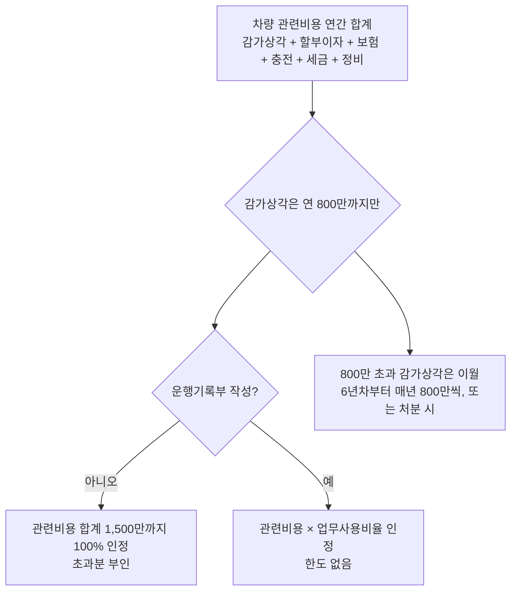
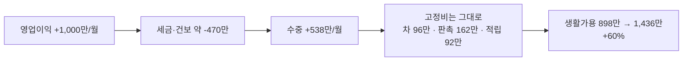

# CSO 개인사업자 — 차량·판촉·가족급여·연금 다 넣고 "수중에 남는 돈" (2026)

- 타임스탬프: 20261014_081507 UTC
- 유형: 분석 + 구현
- 사용자 확정 입력: 창업감면 제외(CSO 불가). 차량 폴스타 4 또는 3 풀할부. 판촉 월 300만(의료인 제외, 제약사 담당자 등). 가족 채용 검토. 연금·노란우산 최대 납입.
- 산출물: `tax_calc/cso_plan.py`

## 1. 결론 — 월 생활가용 (본인 통장에 남아 실제로 쓸 수 있는 돈)

| 월 영업이익 | 전부 반영(폴스타4·판촉300·적립 풀) | + 배우자 급여 250만 (가구 합계) | + 중기특별감면 10% (가구 합계) |
|---|---:|---:|---:|
| 2,000만 | **898만** (+적립 92만 = 990만) | 1,057만 | 1,086만 |
| 3,000만 | **1,436만** (+적립 92만 = 1,528만) | 1,600만 | 1,667만 |

"생활가용"은 할부 원리금, 판촉비, 세금, 건보·연금, 노란우산·연금계좌 적립까지 다 빠진 뒤의 숫자다. 적립 92만/월은 내 자산이므로 체감 가용은 990만/1,528만.

## 2. 한 단계씩 뭐가 얼마나 깎이는가

| 월 영업이익 | 단계 | 본인 생활가용(월) | 전 단계 대비 | 가구 합계(월) |
|---|---|---:|---:|---:|
| 2,000만 | 기준선(차·판촉·적립 없음) | 1,229만 |  | 1,229만 |
| 2,000만 | + 폴스타4 듀얼 풀할부 | 1,133만 | -96만 | 1,133만 |
| 2,000만 | + 판촉 월 300만(적격증빙) | 972만 | -161만 | 972만 |
| 2,000만 | + 노란우산 200 + 연금 900 적립 | 898만 | -74만 | 990만 |
| 2,000만 | + 배우자 급여 250만 | 745만 | -153만 | 1,057만 |
| 2,000만 | + 중기특별감면 10% | 773만 | 29만 | 1,086만 |
| 3,000만 | 기준선(차·판촉·적립 없음) | 1,763만 |  | 1,763만 |
| 3,000만 | + 폴스타4 듀얼 풀할부 | 1,670만 | -93만 | 1,670만 |
| 3,000만 | + 판촉 월 300만(적격증빙) | 1,510만 | -160만 | 1,510만 |
| 3,000만 | + 노란우산 200 + 연금 900 적립 | 1,436만 | -74만 | 1,528만 |
| 3,000만 | + 배우자 급여 250만 | 1,287만 | -149만 | 1,600만 |
| 3,000만 | + 중기특별감면 10% | 1,354만 | 67만 | 1,667만 |

읽는 법
- **폴스타 4 듀얼(7,190만)의 진짜 월 비용은 96만.** 할부 원리금 126만 + 유지비 27만이 나가지만 경비 인정으로 세금 56만이 돌아온다.
- **판촉 300만의 진짜 비용은 162만.** 적격증빙이 있을 때 얘기다. 없으면 300만 전액 내 돈이고 세금 월 116만을 더 낸다.
- **배우자 급여 250만은 가구 기준 월 +68만, 연 +800만.** 본인 세금은 월 153만 줄고 배우자는 세금·보험 떼고 221만 받는다. 배우자 국민연금 월 12만 적립은 덤.
- **중기특별감면 10%는 월 29~67만.** CSO를 상품중개업(도매 범주)으로 등록하면 가능성 있음. 세무사에게 "조특법 7조 적용 가능?" 한 줄만 물어보면 된다.

## 3. 차량 — 폴스타 4 vs 3, 풀할부, 1,500만 한도

### 가격 (2026년형 국내 공식)

| 모델 | 트림 | 가격 | 보조금 | 세제 감면(개소세·교육세·취득세, 2026.12.31까지) | 실구매가 |
|---|---|---:|---:|---:|---:|
| 폴스타 4 | 롱레인지 싱글 | 6,690만 | 서울 약 196만 + 폴스타 100만 | 최대 530만 | 약 5,860만 |
| 폴스타 4 | 롱레인지 듀얼 | 7,190만 | 서울 약 153만 + 폴스타 100만 | 최대 530만 | 약 6,400만 |
| 폴스타 3 | 리어 모터 | 7,790만 | 8,500만 미만 → 50% 구간, 소액 | 최대 530만 | 약 7,100만 |
| 폴스타 3 | 듀얼 모터 | 8,590만 | **0** (8,500만 초과) | 최대 530만 | 약 8,060만 |
| 폴스타 3 | 퍼포먼스 | 9,990만 | 0 | 최대 530만 | 약 9,460만 |

사용자가 예상한 "폴스타4 8~9천, 폴스타3 1억+"보다 싸다. 폴스타3 듀얼이 사용자가 생각한 폴스타4 가격이다.

### 세무 처리 (복식부기의무자 기준, CSO는 매출 7,500만 넘는 2년차부터)



| | 폴스타4 듀얼 (실구매 6,510만) | 폴스타3 듀얼 (실구매 8,060만) |
|---|---:|---:|
| 연 감가상각(5년 정액) | 1,302만 → **800만만 인정**, 502만 이월 | 1,612만 → 800만 인정, 812만 이월 |
| 할부이자 1년차(5.9%, 60개월) | 약 353만 | 약 437만 |
| 보험·충전·세금·정비 | 320만 | 320만 |
| 관련비용 합계 | 1,473만 | 1,557만 |
| 운행기록부 없을 때 인정 | **1,473만 (한도 안)** | 1,500만 (57만 부인) |
| 운행기록부 100% 업무 시 인정 | 1,473만 | 1,557만 |
| 세금 절감(한계 46%) | 약 680만/년 | 약 690만/년 |
| 연 현금 지출(원리금+유지) | 1,827만 | 2,185만 |
| **실질 월 부담** | **약 96만** | **약 125만** |

답: 1,500만 한도 안에서 다 들어온다. 폴스타4는 운행기록부 안 써도 전액 인정이다. 감가상각 800만 한도 때문에 차값의 40%(5년×800만)만 5년 안에 털리고 나머지는 6년차 이후로 밀린다. 공제가 안 되는 게 아니라 **늦게** 된다.

주의
- 전기차도 승용차라 **부가세 매입세액은 불공제**. 차값의 10%(약 650만)는 못 돌려받는다.
- 1대만 보유하면 업무전용 자동차보험 의무 없음(2대째부터). 다만 2026년 귀속 개정 보도가 엇갈려 보험 가입 전 확인.
- 2026 세제개편안에 친환경차 감가상각 한도 800→1,000만 상향 논의가 있다. 통과되면 폴스타3의 이월이 줄어든다.
- 1년차(신규 사업자, 간편장부)는 업무용승용차 한도 규정 미적용. 다만 업무관련성 입증은 동일.

## 4. 판촉비 월 300만 — 증빙 꼭 해야 하나

**해야 한다.** 기업업무추진비는 일반 경비와 달리 **3만원 초과 건에 적격증빙이 없으면 전액 경비 부인**이다(2% 가산세가 아니라 통째로 날아간다). 식당·문구점·마트·의류·백화점 전부 **사업용 신용카드**로 결제하면 그게 증빙이다. 간이영수증·현금은 안 된다.

| | 증빙 있음 | 증빙 없음 |
|---|---:|---:|
| 연 3,600만 지출 | 경비 3,600만 인정 | 경비 0 |
| 세금 차이 | — | **연 1,392~1,410만 더 냄** |
| 월 환산 | 실부담 162만 | 실부담 300만 + 세금 116만 = 416만 |

- 한도: 연 3,600만 + 수입금액×0.3%. 월 300만 = 연 3,600만으로 **딱 한도선**이다. 수수료 매출 1억당 30만씩만 여유가 붙는다. 넘기지 마라.
- 백화점 상품권: 카드로 사면 접대비 가능. 단 "누구에게 줬는지" 기록(수령인·일자·사유) 없으면 세무조사 때 부인될 수 있다. 엑셀 한 줄이면 된다.
- 상대가 제약사 직원이면 약사법 리베이트 규정은 안 걸린다. 다만 제약사 자체 CP(윤리규정)로 직원 수수 금지인 곳이 많다. 세금보다 거래 끊기는 게 리스크다.
- 경조사비는 건당 20만원까지 청첩장·부고장으로 증빙 대체 가능.

## 5. 가족 채용 — 효과 있나

있다. 단, 조건이 있다.

| 항목 | 내용 |
|---|---|
| 효과 | 급여 250만 기준 가구 월 +68만(연 +800만) + 배우자 국민연금 적립 연 142만 |
| 원리 | 내 한계세율 46%에서 빼서 배우자 한계세율 ~6~15%로 옮기는 소득 분산 |
| 조건 | **실제 근무**(지출보고서 작성, 거래처 응대, 서류 등), 급여 계좌이체, 원천세·4대보험 신고. 세무조사 때 근무 입증 못 하면 전액 부인 + 가산세 |
| 안 되는 것 | 통합고용세액공제(가족은 상시근로자 제외), 중소기업취업자 소득세 감면(사업주 배우자·직계 제외) |
| 최적 급여 | 배우자 과세표준 1,400만(세율 6%) 안에 두려면 연 약 2,800만 = 월 230만 전후. 그 이상은 15% 구간이라 효과 체감 |
| 배우자가 이미 피부양자·기본공제 대상이면 | 기본공제 150만 사라짐 → 연 63만 효과 감소. 그래도 순이익 +740만 |

부모님을 쓰는 경우도 같다. 60세 이상은 국민연금 가입 제외라 사업주 부담이 더 작다.

## 6. 연금·노란우산 — 최대한 넣으면

| 항목 | 납입 | 세금 효과 | 성격 |
|---|---:|---:|---|
| 노란우산공제 | 200만(이 소득대 한도) | 84~88만/년 | 폐업·퇴직 시 수령, 압류 금지 |
| 연금저축 600 + IRP 300 | 900만 | 118.8만/년 (13.2%) | 55세 이후 연금 수령, 수령 시 3.3~5.5% |
| 합계 | 1,100만 (월 92만) | 약 205만/년 | **다 내 자산.** 생활가용에서 빠지지만 없어지는 돈이 아님 |

"환급"이 아니라 5월 종소세에서 그만큼 덜 내는 구조다. 사업자는 연말정산이 없으니 통장에 돈이 들어오는 게 아니라 나갈 돈이 줄어든다.

## 7. 2천만 vs 3천만, 어떻게 생각해야 하나



1. 수입이 50% 늘면 수중 돈은 60% 는다. 고정비(차·판촉·적립)가 소득과 무관하게 같은 금액이라, 소득이 커질수록 고정비 비중이 줄어든다. 즉 **3천만 쪽이 세율은 더 높아도 레버리지는 더 좋다.**
2. 2천만에서는 고정비 350만이 수중의 28%, 3천만에서는 19%. 차와 판촉을 "매출을 만드는 장비"로 보면, 2천만에서 폴스타3은 과하고 폴스타4가 맞다. 3천만이면 둘 다 감당된다.
3. 5월과 11월에 세금이 몰린다. 3천만이면 5월 약 4,600만, 11월 약 4,600만이 한 번에 나간다. **매달 세금 몫 760만을 별도 통장에 떼라.** 안 떼면 5월에 할부 차가 넘어간다.
4. 이 숫자는 전부 "감면 없음" 기준이다. 중기특별감면 10%가 되면 월 29~67만, 안 되면 끝. 세무사 확인 한 번이면 끝나는 질문이라 먼저 하라.
5. 과세표준이 2.7~3.1억이다. 3천만 이상으로 가면 법인(10/20%) + 급여 설계가 선행 기록 기준으로 월 70~100만 유리해진다. 지금은 아니고, 월 순이익이 3,500만을 넘는 시점에 다시 계산.

## 8. 전체 시나리오 표


### 월 영업이익 2,000만

| 항목 | 2,000만 · 차·판촉·적립 없음(기준선) | 2,000만 · 폴스타4 듀얼 · 판촉300 · 연금풀 | 2,000만 · 동일 + 중기감면10% | 2,000만 · 동일 + 배우자급여250 | 2,000만 · 폴스타3 듀얼(보조금0) · 판촉300 · 연금풀 |
|---|---:|---:|---:|---:|---:|
| 연 영업이익(입력) | 24,000만 | 24,000만 | 24,000만 | 24,000만 | 24,000만 |
| 차량 실구매가(보조금·세제 후) | 0만 | 6,510만 | 6,510만 | 6,510만 | 8,060만 |
| 차량 경비 인정(감가 800만 한도) | 0만 | 1,473만 | 1,473만 | 1,473만 | 1,500만 |
|   └ 매년 이월되는 감가상각 | 0만 | 502만 | 502만 | 502만 | 812만 |
| 차량 현금 지출(할부 원리금+유지) | 0만 | 1,827만 | 1,827만 | 1,827만 | 2,185만 |
| 판촉·접대 지출 | 0만 | 3,600만 | 3,600만 | 3,600만 | 3,600만 |
|   └ 경비 인정 | 0만 | 3,600만 | 3,600만 | 3,600만 | 3,600만 |
| 가족 급여 + 사업주 4대보험 | 0만 | 0만 | 0만 | 3,320만 | 0만 |
| 건강보험(필요경비) | 1,805만 | 1,424만 | 1,424만 | 1,174만 | 1,422만 |
| = 사업소득금액 | 22,195만 | 17,503만 | 17,503만 | 14,433만 | 17,478만 |
| 국민연금 | 751만 | 751만 | 751만 | 751만 | 751만 |
| 과세표준 | 21,293만 | 16,402만 | 16,402만 | 13,331만 | 16,377만 |
| 소득세+지방세(연금공제 후) | 6,697만 | 4,522만 | 4,056만 | 3,294만 | 4,512만 |
| = 본인 수중 현금(연) | 14,746만 | 11,876만 | 12,343만 | 10,034만 | 11,530만 |
|   └ 그중 적립(노란우산+연금) | 0만 | 1,100만 | 1,100만 | 1,100만 | 1,100만 |
| = 본인 생활가용(월) | 1,229만 | 898만 | 937만 | 745만 | 869만 |
| 가족 실수령(월) | 0만 | 0만 | 0만 | 221만 | 0만 |
| = 가구 합계(월, 적립 포함) | 1,229만 | 990만 | 1,029만 | 1,057만 | 961만 |

### 월 영업이익 3,000만

| 항목 | 3,000만 · 차·판촉·적립 없음(기준선) | 3,000만 · 폴스타4 듀얼 · 판촉300 · 연금풀 | 3,000만 · 동일 + 중기감면10% | 3,000만 · 동일 + 배우자급여250 | 3,000만 · 폴스타3 듀얼(보조금0) · 판촉300 · 연금풀 |
|---|---:|---:|---:|---:|---:|
| 연 영업이익(입력) | 36,000만 | 36,000만 | 36,000만 | 36,000만 | 36,000만 |
| 차량 실구매가(보조금·세제 후) | 0만 | 6,510만 | 6,510만 | 6,510만 | 8,060만 |
| 차량 경비 인정(감가 800만 한도) | 0만 | 1,473만 | 1,473만 | 1,473만 | 1,500만 |
|   └ 매년 이월되는 감가상각 | 0만 | 502만 | 502만 | 502만 | 812만 |
| 차량 현금 지출(할부 원리금+유지) | 0만 | 1,827만 | 1,827만 | 1,827만 | 2,185만 |
| 판촉·접대 지출 | 0만 | 3,600만 | 3,600만 | 3,600만 | 3,600만 |
|   └ 경비 인정 | 0만 | 3,600만 | 3,600만 | 3,600만 | 3,600만 |
| 가족 급여 + 사업주 4대보험 | 0만 | 0만 | 0만 | 3,320만 | 0만 |
| 건강보험(필요경비) | 2,708만 | 2,327만 | 2,327만 | 2,077만 | 2,325만 |
| = 사업소득금액 | 33,292만 | 28,600만 | 28,600만 | 25,530만 | 28,575만 |
| 국민연금 | 751만 | 751만 | 751만 | 751만 | 751만 |
| 과세표준 | 32,391만 | 27,499만 | 27,499만 | 24,429만 | 27,474만 |
| 소득세+지방세(연금공제 후) | 11,389만 | 9,161만 | 8,230만 | 7,877만 | 9,150만 |
| = 본인 수중 현금(연) | 21,152만 | 18,335만 | 19,265만 | 16,548만 | 17,989만 |
|   └ 그중 적립(노란우산+연금) | 0만 | 1,100만 | 1,100만 | 1,100만 | 1,100만 |
| = 본인 생활가용(월) | 1,763만 | 1,436만 | 1,514만 | 1,287만 | 1,407만 |
| 가족 실수령(월) | 0만 | 0만 | 0만 | 221만 | 0만 |
| = 가구 합계(월, 적립 포함) | 1,763만 | 1,528만 | 1,605만 | 1,600만 | 1,499만 |

## 9. 모델 가정

- 영업이익 = 수수료 매출 − 소액 운영비(통신·기장료). 접대비 한도 계산용 수입금액은 보수적으로 영업이익과 동일하게 봄(실제 매출이 크면 한도 조금 더 늘어남).
- 차량: 풀할부 60개월 5.9%, 1년차 이자 기준. 보조금 폴스타4 150만(폴스타 지원금 포함 추정), 폴스타3 듀얼 0. 세제 감면 530만(개소세 300+교육세 90+취득세 140, 2026년 말 일몰).
- 유지비 연 320만(보험 180, 충전 80, 자동차세 13, 정비·세차 50). 업무용 100% 가정.
- 판촉비 전액 적격증빙, 한도 내. 가족 급여는 배우자 기준 직장가입자 4대보험 전부 적용(고용·산재 포함, 보수적).
- 노란우산 200만, 연금계좌 900만 납입. 부양가족 0. 감면 없음(중기 10%는 별도 열).
- 건보 필요경비, 국민연금 소득공제, 고정점 반복 수렴.

## 10. 미확정

| 항목 | 확인처 |
|---|---|
| 중소기업특별세액감면 CSO 적용 가능 여부(업종 분류) | 세무사 |
| 2026년 전기차 보조금 실제 금액(지자체) | 무공해차 통합누리집 |
| 개소세·취득세 감면 2027년 연장 여부 | 기재부 세법개정안 |
| 친환경차 감가상각 한도 1,000만 상향 | 2026 세법개정안 통과 여부 |
| 업무전용 자동차보험 1대 보유 시 의무 여부(2026 귀속) | 소득세법 시행령 78조의3 |
| 제약사별 CP 규정(직원 선물 수수 허용 여부) | 각 위탁 제약사 |

## 11. 사용법

```bash
cd tax_calc
python3 cso_plan.py                          # 2천/3천만 × 5개 시나리오
python3 cso_plan.py --profit 25000000 --json
```
`Plan(...)` 필드로 차종(`car`), 할부금리, 운행기록부(`logbook`, `biz_ratio`), 판촉액, 가족급여, 연금액, 감면 여부를 바꿀 수 있다.

## 12. 출처

- 폴스타4 2026년형 가격·보조금: [폴스타코리아](https://www.polestar.com/kr/news/my-2026-polestar4-released/), [오토데일리](https://www.autodaily.co.kr/news/articleView.html?idxno=533015), [전자신문](https://www.etnews.com/20250626000114), [3프로TV](https://apps.3protv.com/news/view/3958)
- 폴스타3 국내 출시 가격: [파이낸셜뉴스](https://www.fnnews.com/news/202607021713071508), [서울신문](https://www.seoul.co.kr/news/economy/car/2026/07/02/20260702500081), [다나와](https://mauto.danawa.com/news/?Tab=N1&no=6001034&Work=detail&no=6030017), [탑라이더](https://www.top-rider.com/article/view/trd202607060002)
- 전기차 세제·보조금 구간: [겟차 2026 세제](https://web.getcha.kr/blog/2026-automobile-tax-benefits-and-subsidy-policy-guide), [겟차 전기차 세제](https://web.getcha.kr/blog/electric-vehicle-tax-benefits-complete-guide-2026), [glasswallet](https://glasswallet.com/calculate/ev-subsidy/tax-benefit), [daum 2026 제도](https://v.daum.net/v/0RevfJb0lc)
- 업무용승용차 800만·1,500만·이월·리스·전기차 매입세액: [wikidocs 26620](https://wikidocs.net/blog/@Insight_Lab/26620/), [bznav 3074562](https://ai.bznav.com/contents/3074562), [bznav 3180784](https://ai.bznav.com/contents/3180784), [자비스](https://help.jobis.co/hc/ko/articles/115002247893), [watax](https://www.watax.kr/3646b0d2-2682-81f2-9097-f12d720310ab)
- 접대비·연금·노란우산·통합고용 가족 제외: 선행 기록(영업비용 가이드) 출처 참조
