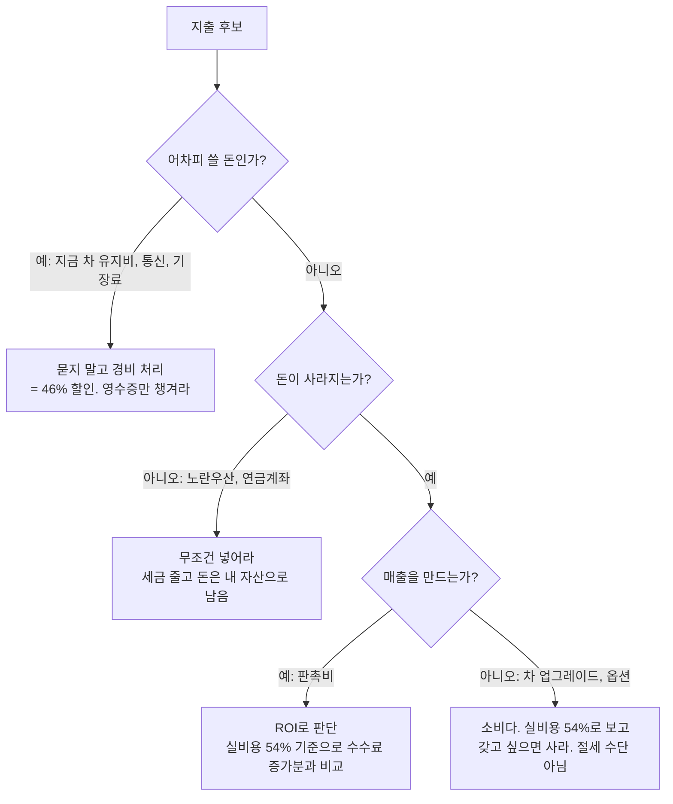

# "안 쓰면 세금으로 날아가나?" — 지출의 분류, 그리고 연 5만 km 기준 차량 재계산

- 타임스탬프: 20261014_081815 UTC
- 유형: 수정 + 분석
- 사용자 추가 입력: 연 주행 5만 km, 옵션 +1,000만, "비용을 안 쓰면 남는 돈인가, 세금으로 날아가는 돈인가" 구분 요청
- 산출물: `tax_calc/cso_plan.py` 갱신 (주행거리 기반 충전비·타이어, 옵션, 기존차 시나리오)

## 1. 원칙 — 세금 때문에 쓰는 돈은 항상 손해다

당신 한계부담률은 46%다. 100만을 벌었을 때:

| | 안 쓴다 | 경비로 쓴다 |
|---|---:|---:|
| 세금·건보로 나감 | 46만 | 0 |
| 통장에 남음 | **54만** | 0 |
| 손에 쥔 물건·서비스 | 없음 | 100만짜리 |

"다 날아간다"는 틀렸다. 46%만 날아가고 54%는 남는다. 경비 처리는 **54% 가격에 사는 것**이지 공짜가 아니다. 그래서 질문은 "세금 아끼려고 쓸까"가 아니라 **"54% 가격이면 이걸 사겠는가"**다.

| 유형 | 예 | 판단 기준 | 당신 케이스 |
|---|---|---|---|
| ① 어차피 쓸 돈 | 지금 차 연료·보험·정비, 통신, 기장료, 법정교육 | 생각할 것 없음. 경비 처리 = 46% 할인 | 기존차 연 978만 → 세후 528만 |
| ② 돈이 안 사라지는 지출 | 노란우산 200, 연금계좌 900 | 유일하게 "세금만 줄고 돈은 남는" 항목. 한도까지 | 연 205만 절세, 1,100만은 내 자산 |
| ③ 돈 버는 지출 | 판촉비 월 300 | 실비용 162만 → 수수료가 월 162만 이상 늘면 이득 | 효과 측정 가능하게 거래처별 기록 |
| ④ 소비 | 기존차→폴스타, 옵션 1,000만 | 실비용 54%로 환산해 효용 판단. 세금은 핑계 안 됨 | 아래 계산 |

## 2. 차량 — 연 5만 km, 옵션 1,000만 반영

### 충전비가 유지비 1위가 된다

| | 기존차(내연, 연비 12km/L) | 폴스타4 듀얼 | 폴스타3 듀얼 |
|---|---:|---:|---:|
| 에너지(연 5만 km) | 연료 687만 | **충전 448만** | 충전 495만 |
| 타이어(4만 km마다 150만) | (정비에 포함) | 188만 | 188만 |
| 보험·정비·세금 | 291만 | 243만 | 243만 |
| 유지비 합계 | 978만 | 879만 | 926만 |

전비: 폴스타4 듀얼 인증 4.2 km/kWh, 폴스타3 듀얼 약 3.8 (486km/106kWh 역산). 실주행은 겨울 포함 15% 낮게 봄. 충전 단가 320원/kWh(아파트 완속 ~295, 급속 350~393 혼합). 급속만 쓰면 충전비 550만까지 간다.

### 5만 km면 운행기록부를 써야 한다

| | 폴스타4 듀얼+옵션 | 폴스타3 듀얼+옵션 |
|---|---:|---:|
| 실구매가(옵션·취득세 포함, 보조금·감면 후) | 7,580만 | 9,130만 |
| 관련비용(감가 800만 한도 + 이자 + 유지비) | 2,090만 | 2,221만 |
| 운행기록부 없음 → 1,500만 한도 | 1,500만 인정, **590만 부인** | 1,500만 인정, 721만 부인 |
| 운행기록부 작성, 업무 90% | 1,881만 인정 | 1,999만 인정 |
| 기록부 효과(세금) | 연 약 175만 | 연 약 230만 |
| 매년 이월 감가상각 | 716만 | 1,026만 |

지난 기록에서 "1만 km면 기록부 없어도 한도 안"이었는데, 5만 km는 충전비만으로 한도를 넘긴다. 앱(티맵·카카오내비 운행일지, 또는 홈택스 서식)으로 기록하라. 1년차(간편장부)는 한도 규정이 없으니 업무비율만 입증하면 된다.

옵션 1,000만은 보조금 판정에 영향 없다(기본가 기준). 취득세 70만 추가, 감가상각 대상 늘어남.

### 기존차 vs 폴스타 — 실제 월 부담 차이

| 월 영업이익 | 기존차 유지 | 폴스타4(기록부 O) | 차이 | 폴스타3(기록부 O) | 차이 |
|---|---:|---:|---:|---:|---:|
| 2,000만 | 생활가용 950만 | 847만 | **−103만/월** | 817만 | −133만/월 |
| 3,000만 | 생활가용 1,488만 | 1,385만 | **−103만/월** | 1,355만 | −133만/월 |

폴스타4의 세전 현금 지출은 연 2,633만(원리금 1,754 + 유지 879), 기존차는 978만. 차이 1,655만 중 세금으로 약 420만 돌아와서 **실비용 연 1,235만 = 월 103만**이다. 이게 유형 ④ 소비의 가격표다. 5년이면 6,200만.

판단: "월 103만 내고 폴스타4를 탈 것인가"를 소비로 결정하면 된다. 세금은 이미 계산에 들어가 있다. 연 5만 km를 타는 사람에게 피로도·안전·충전 편의는 실질 효용이니 사도 이상하지 않다. 다만 절세 때문에 산다는 논리는 성립하지 않는다.

주의: 연 5만 km × 5년 = 25만 km. 배터리 보증(8년/16만 km)을 4년 차에 넘긴다. 중고 잔존가치는 세무 감가상각(5년 정액)과 무관하게 급락한다. 할부 끝나는 시점에 차값이 거의 0일 수 있다.

## 3. 갱신된 월 생활가용 요약

| 월 영업이익 | 기존차 | 폴스타4 (기록부 O) | 폴스타3 (기록부 O) | 폴스타4 + 배우자급여 (가구) |
|---|---:|---:|---:|---:|
| 2,000만 | 950만 | 847만 | 817만 | 1,004만 |
| 3,000만 | 1,488만 | 1,385만 | 1,355만 | 1,548만 |

모두 판촉 300만·노란우산 200·연금 900 적립 반영 후. 적립 월 92만은 별도로 내 자산.

## 4. 전체 표

### 월 영업이익 2,000만

| 항목 | 2,000만 · 차·판촉·적립 없음(기준선) | 2,000만 · 기존차 유지 · 판촉300 · 적립풀 | 2,000만 · 폴스타4 듀얼+옵션1000 · 운행기록부 X | 2,000만 · 폴스타4 듀얼+옵션1000 · 운행기록부 O(90%) | 2,000만 · 폴스타3 듀얼+옵션1000 · 운행기록부 O(90%) | 2,000만 · 폴스타4(기록부O) + 배우자급여250 |
|---|---:|---:|---:|---:|---:|---:|
| 연 영업이익(입력) | 24,000만 | 24,000만 | 24,000만 | 24,000만 | 24,000만 | 24,000만 |
| 차량 실구매가(보조금·세제 후) | 0만 | 0만 | 7,580만 | 7,580만 | 9,130만 | 7,580만 |
| 차량 유지비(충전·타이어·보험·정비·세금) | 0만 | 978만 | 879만 | 879만 | 926만 | 879만 |
|   └ 그중 충전비 | 0만 | 0만 | 448만 | 448만 | 495만 | 448만 |
| 차량 관련비용 합계(감가 800만 한도 적용) | 0만 | 978만 | 2,090만 | 2,090만 | 2,221만 | 2,090만 |
| 차량 경비 인정 | 0만 | 978만 | 1,500만 | 1,881만 | 1,999만 | 1,881만 |
|   └ 매년 이월되는 감가상각 | 0만 | 0만 | 716만 | 716만 | 1,026만 | 716만 |
| 차량 현금 지출(할부 원리금+유지) | 0만 | 978만 | 2,633만 | 2,633만 | 3,039만 | 2,633만 |
| 판촉·접대 지출 | 0만 | 3,600만 | 3,600만 | 3,600만 | 3,600만 | 3,600만 |
|   └ 경비 인정 | 0만 | 3,600만 | 3,600만 | 3,600만 | 3,600만 | 3,600만 |
| 가족 급여 + 사업주 4대보험 | 0만 | 0만 | 0만 | 0만 | 0만 | 3,320만 |
| 건강보험(필요경비) | 1,805만 | 1,461만 | 1,422만 | 1,393만 | 1,384만 | 1,143만 |
| = 사업소득금액 | 22,195만 | 17,961만 | 17,478만 | 17,126만 | 17,017만 | 14,056만 |
| 국민연금 | 751만 | 751만 | 751만 | 751만 | 751만 | 751만 |
| 과세표준 | 21,293만 | 16,860만 | 16,377만 | 16,025만 | 15,915만 | 12,954만 |
| 소득세+지방세(연금공제 후) | 6,697만 | 4,714만 | 4,512만 | 4,364만 | 4,319만 | 3,148만 |
| = 본인 수중 현금(연) | 14,746만 | 12,497만 | 11,082만 | 11,258만 | 10,907만 | 9,404만 |
|   └ 그중 적립(노란우산+연금) | 0만 | 1,100만 | 1,100만 | 1,100만 | 1,100만 | 1,100만 |
| = 본인 생활가용(월) | 1,229만 | 950만 | 832만 | 847만 | 817만 | 692만 |
| 가족 실수령(월) | 0만 | 0만 | 0만 | 0만 | 0만 | 221만 |
| = 가구 합계(월, 적립 포함) | 1,229만 | 1,041만 | 924만 | 938만 | 909만 | 1,004만 |

### 월 영업이익 3,000만

| 항목 | 3,000만 · 차·판촉·적립 없음(기준선) | 3,000만 · 기존차 유지 · 판촉300 · 적립풀 | 3,000만 · 폴스타4 듀얼+옵션1000 · 운행기록부 X | 3,000만 · 폴스타4 듀얼+옵션1000 · 운행기록부 O(90%) | 3,000만 · 폴스타3 듀얼+옵션1000 · 운행기록부 O(90%) | 3,000만 · 폴스타4(기록부O) + 배우자급여250 |
|---|---:|---:|---:|---:|---:|---:|
| 연 영업이익(입력) | 36,000만 | 36,000만 | 36,000만 | 36,000만 | 36,000만 | 36,000만 |
| 차량 실구매가(보조금·세제 후) | 0만 | 0만 | 7,580만 | 7,580만 | 9,130만 | 7,580만 |
| 차량 유지비(충전·타이어·보험·정비·세금) | 0만 | 978만 | 879만 | 879만 | 926만 | 879만 |
|   └ 그중 충전비 | 0만 | 0만 | 448만 | 448만 | 495만 | 448만 |
| 차량 관련비용 합계(감가 800만 한도 적용) | 0만 | 978만 | 2,090만 | 2,090만 | 2,221만 | 2,090만 |
| 차량 경비 인정 | 0만 | 978만 | 1,500만 | 1,881만 | 1,999만 | 1,881만 |
|   └ 매년 이월되는 감가상각 | 0만 | 0만 | 716만 | 716만 | 1,026만 | 716만 |
| 차량 현금 지출(할부 원리금+유지) | 0만 | 978만 | 2,633만 | 2,633만 | 3,039만 | 2,633만 |
| 판촉·접대 지출 | 0만 | 3,600만 | 3,600만 | 3,600만 | 3,600만 | 3,600만 |
|   └ 경비 인정 | 0만 | 3,600만 | 3,600만 | 3,600만 | 3,600만 | 3,600만 |
| 가족 급여 + 사업주 4대보험 | 0만 | 0만 | 0만 | 0만 | 0만 | 3,320만 |
| 건강보험(필요경비) | 2,708만 | 2,364만 | 2,325만 | 2,296만 | 2,287만 | 2,046만 |
| = 사업소득금액 | 33,292만 | 29,059만 | 28,575만 | 28,223만 | 28,114만 | 25,153만 |
| 국민연금 | 751만 | 751만 | 751만 | 751만 | 751만 | 751만 |
| 과세표준 | 32,391만 | 27,957만 | 27,474만 | 27,122만 | 27,013만 | 24,052만 |
| 소득세+지방세(연금공제 후) | 11,389만 | 9,352만 | 9,150만 | 9,003만 | 8,957만 | 7,720만 |
| = 본인 수중 현금(연) | 21,152만 | 18,955만 | 17,541만 | 17,717만 | 17,366만 | 15,930만 |
|   └ 그중 적립(노란우산+연금) | 0만 | 1,100만 | 1,100만 | 1,100만 | 1,100만 | 1,100만 |
| = 본인 생활가용(월) | 1,763만 | 1,488만 | 1,370만 | 1,385만 | 1,355만 | 1,236만 |
| 가족 실수령(월) | 0만 | 0만 | 0만 | 0만 | 0만 | 221만 |
| = 가구 합계(월, 적립 포함) | 1,763만 | 1,580만 | 1,462만 | 1,476만 | 1,447만 | 1,548만 |

## 5. 가정 변경

- 주행 연 5만 km. 충전 320원/kWh, 인증 전비 × 0.85. 타이어 150만/4만 km. 보험 180, 정비 50, 자동차세 13.
- 기존차: 연비 12 km/L, 1,650원/L, 정비·타이어 150, 보험 100, 세금 40. 할부 없음.
- 옵션 1,000만 → 취득가액 + 취득세 7%. 보조금 판정은 기본가.
- 운행기록부 O 시 업무비율 90%.

## 6. 출처

- 폴스타4 듀얼 제원·전비 4.2: [오토뷰 2027 폴스타4 듀얼](https://www.autoview.co.kr/ko-kr/articles/100868), [오토뷰 비교](https://www.autoview.co.kr/ko-kr/articles/98785)
- 폴스타3 주행거리 486km·가격: [폴스타코리아 MY27](https://www.polestar.com/kr/news/polestar-3-my27-launch), [헤럴드경제](https://www.heraldk.com/article/2026070519234406788)
- 충전요금 2026(초급속 393.1, 아파트 완속 ~295, 공공 347/324): [겟차 충전요금 가이드](https://web.getcha.kr/blog/ev-charging-cost-calculation-guide-2026), [daum 충전요금 인상](https://v.daum.net/v/0k3ffIFYOD), [wikidocs](https://wikidocs.net/blog/@knarchive/14970/)
- 업무용승용차 한도·이월: 선행 기록 출처
