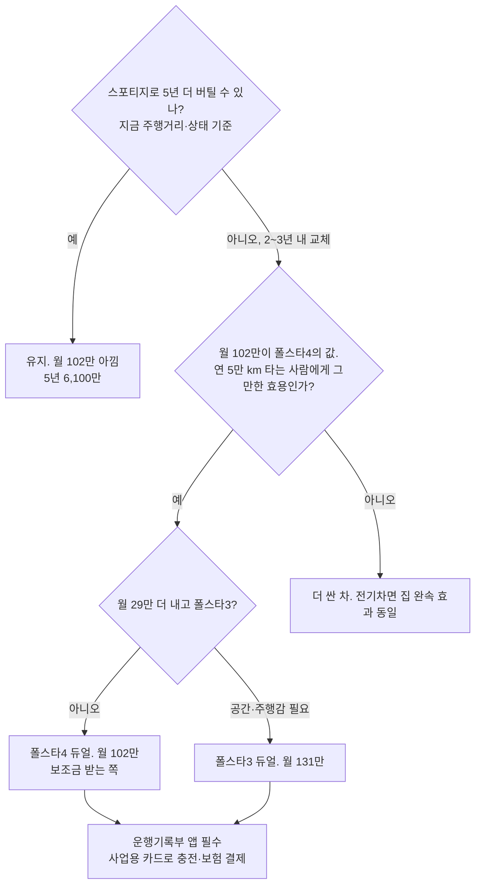

# 차를 바꿀 것인가 — 통장 기준으로 다시 설명 (스포티지 디젤 vs 폴스타 4 vs 폴스타 3)

- 타임스탬프: 20261014_132913 UTC
- 유형: 분석
- 사용자 확정 입력: 집 완속 충전 있음. 현재 차 스포티지 디젤 연비 14 km/L. 중소기업특별감면 없음으로 확정. 연 5만 km. 옵션 +1,000만.
- 변경: `cso_plan.py` 기본값을 위 입력으로 갱신 (충전 220원/kWh, 경유 1,550원/L, 14 km/L)

## 1. 먼저 오해 세 개를 풀자

**오해 1. "1,500만 한도를 쓰는 게 맞느냐"**
1,500만은 혜택이 아니다. **천장**이다. 세무서가 "운행기록부 없으면 차에 쓴 돈 중 1,500만까지만 경비로 봐주겠다"는 상한선이다. 쓰든 안 쓰든 당신에게 돈을 주는 게 아니다. 차에 2,000만을 썼는데 기록부가 없으면 1,500만만 경비고 500만은 그냥 당신 돈으로 쓴 것이 된다. 그래서 "한도를 채운다"는 생각 자체를 버려라. 차에 돈을 쓰면 쓴 만큼(천장 안에서) 경비가 되고, 그 경비의 46%가 세금에서 빠진다. 끝.

**오해 2. "안 쓰면 돈이 많이 돌아오느냐"**
안 쓰면 돌아오는 게 아니라 **애초에 안 나간다.** 차에 1,000만 쓰면 460만은 세금에서 빠지고 540만은 당신 돈이 나간다. 안 쓰면 1,000만 중 460만은 세금으로 내고 540만이 통장에 남는다. 두 경우 다 540만이 걸려 있다. 차이는 "540만 내고 차를 얻느냐" vs "540만을 통장에 두느냐"다.

**오해 3. "할부 이자도 생각해야 되는데"**
맞다. 그리고 이미 들어가 있다. 할부 이자는 세무서가 차량 관련비용으로 인정한다(천장 안에서). 1년차 이자 411만 중 46%인 190만은 세금에서 빠지고, 221만은 당신이 은행에 주는 돈이다.

## 2. 통장 기준 1년 (월 순익 3,000만, 연 5만 km)

| | 스포티지 유지 | 폴스타4 듀얼+옵션 | 폴스타3 듀얼+옵션 |
|---|---:|---:|---:|
| ① 통장에서 나가는 돈: 할부 원리금(5년, 5.9%) | 0 | 1,754만 (이자 411 포함) | 2,113만 (이자 495 포함) |
| ② 통장에서 나가는 돈: 연료/충전 | 경유 554만 | 충전 308만 | 충전 341만 |
| ③ 통장에서 나가는 돈: 타이어·보험·정비·세금 | 290만 | 431만 | 431만 |
| **차에 나가는 현금 합계** | **844만** | **2,493만** | **2,884만** |
| 세무서가 경비로 인정 (기록부 O, 업무 90%) | 844만 | 1,755만 | 1,860만 |
| 그래서 스포티지 대비 세금·건보를 덜 냄 | 0 | 421만 | 469만 |
| **스포티지 대비 내 돈이 더 나감 (연)** | 0 | **1,228만** | **1,571만** |
| **= 월** | 0 | **102만** | **131만** |

읽는 법
- 폴스타4로 바꾸면 통장에서 연 1,649만이 더 나가고(2,493 − 844), 세금에서 421만이 돌아온다. 결국 **연 1,228만, 월 102만**이 "폴스타4를 타는 값"이다.
- 폴스타3은 월 131만. 폴스타4와의 차이는 **월 29만**. 차값 1,550만 차이가 5년 할부·세금 거쳐 월 29만으로 나온다.
- 집 완속이라 충전비가 경유의 절반 수준(308 vs 554)이다. 이게 폴스타의 유일한 "절약"이고 연 246만이다. 나머지는 전부 소비다.
- 운행기록부 안 쓰면 폴스타4 기준 월 10만 더 든다(경비 1,755 → 1,500 천장). 앱 하나면 끝나는 일이다.

## 3. 5년 합산 (할부 끝나는 시점)

| | 스포티지 유지 | 폴스타4 | 폴스타3 |
|---|---:|---:|---:|
| 5년간 차에 나가는 현금 | 약 4,200만 | 약 1억 2,500만 | 약 1억 4,400만 |
| 5년간 세금에서 돌아옴 | 약 1,900만 | 약 4,000만 | 약 4,300만 |
| **5년 순부담** | **약 2,300만** | **약 8,500만** | **약 1억 100만** |
| 5년 뒤 차 상태 | 주행 25만 km 추가, 잔존가 ~0, 교체 필요 | 주행 25만 km, 배터리 보증 종료, 잔존가 1,000~1,500만 추정 | 동일 |
| 세무상 남는 것 | 없음 | 감가상각 이월 약 3,600만 (6년차부터 800만씩 경비) | 이월 약 5,100만 |

5년 뒤 스포티지는 어차피 바꿔야 한다. 그러니 진짜 비교는 "지금 폴스타 vs 2~3년 뒤 다른 차"다. 스포티지를 더 타는 건 결정을 미루는 것이지 돈을 안 쓰는 게 아니다.

## 4. 결론

세금은 이 결정을 바꾸지 않는다. 세금은 모든 선택지에서 똑같이 46%를 할인해 줄 뿐이다. 결정은 "월 102만(또는 131만)짜리 소비를 하겠는가"다.

## 5. 가정

- 월 순익 3,000만 기준(2,000만이어도 차 부담 월 102/131만은 동일). 판촉 300만·노란우산·연금 반영.
- 할부 60개월 5.9%, 1년차 이자. 보조금 폴스타4 150만, 폴스타3 0. 세제 감면 530만.
- 충전 220원/kWh(집 완속 위주), 인증 전비 × 0.85. 타이어 150만/4만 km. 스포티지 정비·타이어 150만, 보험 100만, 자동차세 40만.
- 5년 합산은 1년차 수치 × 5 근사(이자는 해마다 줄어 실제는 약간 유리).
