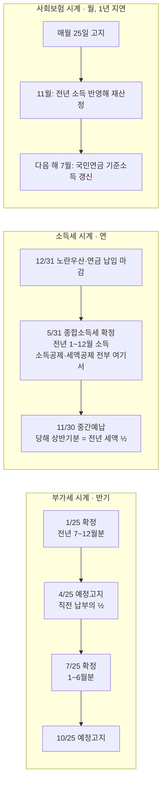

# 연간 합계와 납부 캘린더 — 부가세·종합소득세·건보·연금은 각각 언제 나가나

- 타임스탬프: 20261014_133145 UTC
- 유형: 분석
- 기준: 월 순익 2,000만 / 3,000만, 폴스타4 듀얼+옵션(운행기록부 O), 판촉 300만, 노란우산 200·연금 900, 감면 없음, 창업 연도를 Y로 표기
- 선행: cso_plan.py 결과 재사용. 수수료 매출은 순익 + 경비로 역산(부가세 추정용)

## 1. 연간 한 장 요약

| 항목 (연) | 월 순익 2,000만 | 월 순익 3,000만 | 언제 나가나 |
|---|---:|---:|---|
| 추정 수수료 매출(공급가액) | 2억 9,655만 | 4억 1,655만 | 세금계산서 발행 시 |
| 제약사가 수수료에 얹어주는 부가세 10% | 2,965만 | 4,165만 | 입금 시 함께 들어옴. **내 돈 아님** |
| 납부 부가세(매입세액 30만 차감) | 2,935만 | 4,135만 | 1월·7월 (2년차부터 4월·10월 예정고지 포함) |
| 사업소득금액 | 1억 7,242만 | 2억 8,340만 | — |
| 소득세+지방소득세 | 4,413만 | 9,052만 | **5월** (2년차부터 11월 중간예납 절반) |
| 건강보험+장기요양 | 1,403만 | 2,305만 | 매월 (단, 소득 반영은 다음 해 11월부터) |
| 국민연금 | 751만 | 751만 | 매월 |
| 차량 현금(할부+유지) | 2,493만 | 2,493만 | 매월 |
| 판촉 | 3,600만 | 3,600만 | 매월 |
| 적립(노란우산 200 + 연금 900) | 1,100만 | 1,100만 | 12/31까지 납입해야 그해 공제 |
| **연 생활가용** | **1억 240만 (월 853만)** | **1억 6,699만 (월 1,392만)** | |

## 2. 세 개의 시계가 따로 돈다

세액공제·소득공제는 전부 **5월 종합소득세 신고 때 한 번** 반영된다. 사업자는 연말정산이 없으므로 "환급 통장에 돈이 들어오는" 일은 거의 없고, 5월에 낼 세금이 그만큼 줄어든다. 연금계좌 900만을 12/31까지 넣으면 다음 해 5월 세금이 119만 줄어드는 식이다.

## 3. 창업 후 3년 캘린더 (월 순익 3,000만 기준)

| 시점 | 부가세 | 소득세 | 건보·연금 | 비고 |
|---|---:|---:|---:|---|
| **Y년** 창업 | | | 연금 월 63만(신고소득 기준), 건보 월 약 2만(소득자료 없음, 무재산) | 1년차는 **간편장부 대상**. 복식부기로 신고하면 기장세액공제 20%(한도 100만) |
| Y년 7/25 | 1~6월분 확정 (개업 시기에 따라 첫 신고) | | | 예정고지 없음(직전 실적 없음) |
| Y+1년 1/25 | Y년 7~12월분 확정 약 2,068만 | | | |
| Y+1년 4/25 | 예정고지 약 1,034만 | | | |
| **Y+1년 5/31** | | **Y년분 전액 약 9,052만** | | 중간예납이 없었으므로 **한 번에** 나감. 가장 큰 고비 |
| Y+1년 7/25 | 확정 약 1,034만(예정고지 차감 후) | | | 이때부터 Y+1년은 **복식부기 의무**(직전 매출 7,500만↑) |
| Y+1년 7월 | | | 국민연금 Y년 소득 반영 → 상한 월 63만 유지 | |
| Y+1년 10/25 | 예정고지 약 1,034만 | | | |
| **Y+1년 11월** | | 중간예납 약 4,526만 | **건보 Y년 소득 반영 → 월 192만으로 급등** | 두 개가 같은 달에 온다 |
| Y+2년 1/25 | 확정 약 1,034만 | | | |
| Y+2년 5/31 | | Y+1년분 잔액 약 4,526만 | | 이후 매년 5월·11월 반반 |

1년차에 건보가 연 2,300만 덜 나가는 건 **절약이 아니라 지연**이다. Y+1년 11월부터 매월 192만이 붙고, 그때 소득세 중간예납 4,526만도 같이 온다. 1년차에 번 돈을 다 쓰면 Y+1년 5월과 11월에 두 번 무너진다.

## 4. 부가세 — CSO 기준으로 제대로

| 질문 | 답 |
|---|---|
| 내 수수료에 부가세가 붙나 | 붙는다. 판촉 용역은 과세 10%. 제약사에 세금계산서를 끊고 수수료 + 10%를 받는다 |
| 그 10%는 내 돈인가 | 아니다. 받았다가 1월·7월에 그대로 낸다. **입금되는 순간 별도 통장으로 옮겨라.** 월 순익 3,000만이면 월 345만씩 쌓인다 |
| 매입세액으로 뺄 수 있는 건 | 통신, 기장료, 사무용품, 노트북, 광고, 교육비 정도. 연 30만 수준이라 사실상 없다 |
| 못 빼는 건 | **승용차(전기차 포함) 구입·충전·보험·수리**, **접대비·판촉비(선물·식사)**. CSO 지출의 90%가 여기 해당 → 부가세는 매출의 10% 거의 그대로 낸다 |
| 신고 횟수 | 개인 일반과세자: 확정 2회(1월·7월) + 예정고지 2회(4월·10월, 직전 확정세액의 ½, 50만 미만이면 고지 안 함). 2년차부터 사실상 분기마다 돈이 나간다 |
| 전자세금계산서 | 직전연도 공급가액 8천만 이상이면 **의무 발급**. 2년차부터 해당. 발급 시 건당 200원 세액공제(연 100만 한도, 직전 매출 3억 미만) |
| 발행 시점 | 용역 제공 완료일(보통 월말 정산). 월 합계로 **다음 달 10일까지** 발급. 늦으면 공급가액 1% 가산세 |
| 제약사가 수수료를 늦게 주면 | 상관없이 세금계산서 발행 기준으로 부가세를 낸다. **미수금 있어도 납부.** CSO 업계 결제 지연이 흔하니 이게 현금 리스크 1순위 |
| 예정고지가 너무 많으면 | 상반기 실적이 직전 반기의 1/3 미만이면 예정신고로 바꿔 실제 금액만 낼 수 있다 |

## 5. 매달 떼어 놓아야 하는 돈 (월 순익 3,000만)

| 통장 | 월 적립 | 용도 |
|---|---:|---|
| 부가세 보관 | 345만 | 입금된 10%. 내 돈이 아님 |
| 소득세 적립 | 754만 | 5월·11월 납부용 (9,052만 ÷ 12) |
| 건보·연금 | 255만 | 자동이체. 1년차엔 건보 몫 192만을 **미리 적립** |
| 적립(노란우산·연금) | 92만 | 12월 전 납입 완료 |
| **합계** | **1,446만** | 이걸 떼고 남는 1,392만이 생활가용 |

월 순익 2,000만이면 부가세 245만, 소득세 368만, 건보·연금 180만, 적립 92만 = 885만 떼고 853만.

## 6. 공제 받는 시점 정리

| 공제 | 납입/지출 마감 | 반영 시점 | 효과 |
|---|---|---|---|
| 노란우산 200만 | Y년 12/31 | Y+1년 5월 종소세 | 세금 88만 감소 |
| 연금저축 600 + IRP 300 | Y년 12/31 | Y+1년 5월 | 세금 119만 감소 |
| 국민연금 납부액 | 매월 | Y+1년 5월 소득공제 | 세금 330만 감소 |
| 차량·판촉·건보 경비 | Y년 중 지출, 증빙 | Y+1년 5월 | 과세표준에서 차감 |
| 기장세액공제(1년차만) | 복식부기로 신고 | Y+1년 5월 | 최대 100만 |
| 부가세 매입세액 | 세금계산서·카드 수취 | 다음 1월·7월 | 연 30만 |

## 7. 다음 행동

1. 통장 4개 분리(사업 입금 / 부가세 보관 / 세금 적립 / 생활). 입금 즉시 자동이체 규칙 설정.
2. 1년차 11월 전에 Y+1년 5월 종소세 9,052만 + 11월 중간예납 4,526만 + 건보 인상분을 합친 **약 1억 4천만 현금**을 확보. 1년차가 제일 많이 남는 해처럼 보이지만 그 돈의 절반은 다음 해 세금이다.
3. 계약서에 수수료 결제 조건(월말 마감, 익월 말 입금 등)을 못 박고, 세금계산서 발행일과 입금일 차이를 줄여라.
