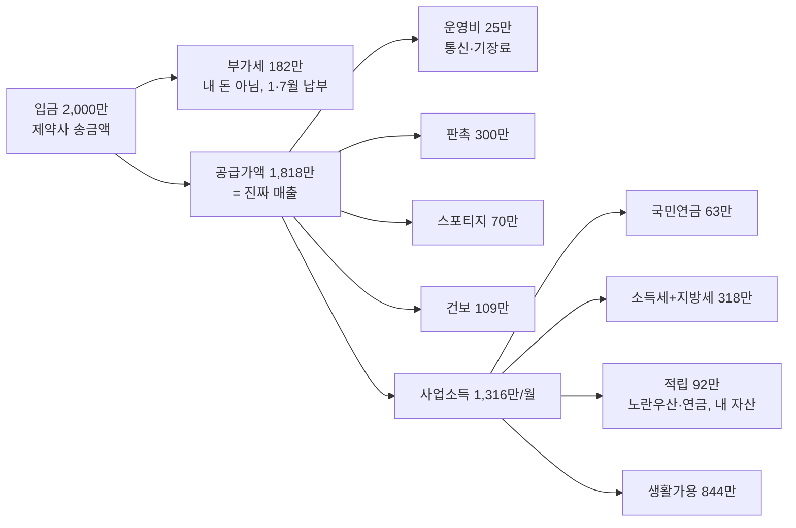

# "2,000만은 부가세 포함 입금액" — 전제 수정 후 재계산

- 타임스탬프: 20261014_134108 UTC
- 유형: 수정 + 분석
- 사용자 정정: 월 2,000만/3,000만은 순익이 아니라 **부가세 포함 입금액(수수료 + 10%)**.
- 변경: `cso_plan.py`에 `--deposit`(부가세 포함 입금) 모드 추가. 영업이익 = 입금 ÷ 1.1 − 월 운영비 25만(통신·기장료·소모품).
- 조건: 스포티지 유지, 판촉 300만, 노란우산 200·연금 900, 감면 없음, 연 5만 km, 2026.11~12 창업

## 1. 입금 2,000만이 어떻게 844만이 되나

## 2. 입금액별 한 장 표

| 월 입금(VAT 포함) | 공급가액 | 부가세 보관 | 과세표준 | 구간 | 소득세+지방세(연) | 건보+연금(연) | **월 생활가용** |
|---:|---:|---:|---:|---|---:|---:|---:|
| 1,000만 | 909만 | 91만 | 4,510만 | 15% | 465만 | 1,005만 | 275만 |
| 1,500만 | 1,364만 | 136만 | 9,645만 | 35% | 1,874만 | 1,625만 | 585만 |
| **2,000만** | **1,818만** | **182만** | **1억 4,689만** | **35%** | **3,816만** | **2,036만** | **844만** |
| 2,500만 | 2,273만 | 227만 | 1억 9,733만 | 38% | 5,914만 | 2,446만 | 1,089만 |
| **3,000만** | **2,727만** | **273만** | **2억 4,777만** | **38%** | **8,023만** | **2,856만** | **1,334만** |
| 3,500만 | 3,182만 | 318만 | 2억 9,821만 | 38% | 1억 131만 | 3,267만 | 1,578만 |
| 4,000만 | 3,636만 | 364만 | 3억 4,866만 | 40% | 1억 2,347만 | 3,677만 | 1,814만 |

입금 2,000만은 과세표준 1.47억으로 **35% 구간**이다(1.5억 직전). 입금 약 2,050만부터 38%. 입금 3,000만은 38% 중간. 40%는 입금 약 3,500만 이상.

지난 기록("순익 2,000만" 기준 생활가용 956만)과의 차이 112만은 부가세 182만을 매출로 잘못 넣었던 것 때문이다.

## 3. 입금 2,000만: 스포티지 vs 폴스타

| 연 | 스포티지 | 폴스타4 듀얼+옵션 | 폴스타3 듀얼+옵션 |
|---|---:|---:|---:|
| 차에 나가는 현금 | 844만 | 2,493만 | 2,884만 |
| 세무서 경비 인정 | 844만 | 1,755만 | 1,860만 |
| 과세표준 | 1억 4,689만 | 1억 3,846만 | 1억 3,749만 |
| 소득세+지방세 | 3,816만 | 3,492만 | 3,454만 |
| 건보+연금 | 2,036만 | 1,967만 | 1,959만 |
| **월 생활가용** | **844만** | **739만** | **710만** |
| 스포티지 대비 월 부담 | 0 | **105만** | **134만** |

입금 3,000만이면 1,334만 / 1,231만 / 1,203만, 부담 102만 / 131만.

차 부담이 소득과 무관하게 월 102~134만으로 일정한 이유: 한계세율이 두 소득대 모두 35~38%라 세금 환급 비율이 거의 같다.

## 4. 매달 떼놓을 돈

| | 입금 2,000만 | 입금 3,000만 |
|---|---:|---:|
| 부가세 보관 (내 돈 아님) | 182만 | 273만 |
| 소득세 적립 (5월·11월용) | 318만 | 669만 |
| 건보·연금 (2028.11 전까지 건보 몫 미리 적립) | 170만 | 238만 |
| 노란우산·연금 (12월 전 납입) | 92만 | 92만 |
| **떼놓는 합계** | **761만** | **1,271만** |
| 판촉 | 300만 | 300만 |
| 스포티지 | 70만 | 70만 |
| 운영비 | 25만 | 25만 |
| **생활가용** | **844만** | **1,334만** |
| 검산(합계 = 입금) | 2,000만 | 3,000만 |

## 5. 11~12월 창업 캘린더 (입금 2,000만, 2027년 내내 유지 가정)

| 시점 | 금액 |
|---|---:|
| 2027.1.25 첫 부가세(2026.11~12월분) | 약 360만 |
| 2027.5.31 2026년분 소득세 | 거의 0 (2027년은 간편장부) |
| 2027.7.25 부가세 상반기 | 약 1,080만 |
| 2027.11 중간예납 | 0 (2026 세액 없음) |
| 2028.1.25 부가세 하반기 | 약 1,080만 (4·10월 예정고지로 반씩 선납) |
| **2028.5.31 2027년분 소득세 전액** | **약 3,816만** |
| **2028.11 중간예납 + 건보 시작** | **약 1,908만 + 월 109만** |

## 6. 가정

- 운영비 월 25만. 판촉 300만 유지(공급가액의 16.5% — 매출 대비 무겁다. 실제 집행은 거래처별 효과 보고 조정).
- 접대비 한도 3,600만 + 2.18억×0.3% = 3,665만 → 300만/월은 한도 안.
- 수수료 매출 2.18억(2,000만) / 3.27억(3,000만): 2028년부터 복식부기 의무(7,500만↑), 전자세금계산서 의무(8천만↑). 성실신고확인(5억) 미해당.
