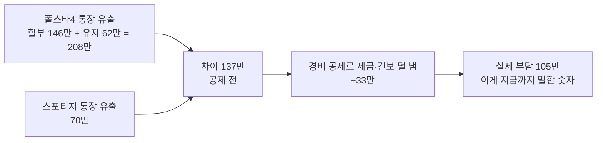

# "월 부담 105만에 공제를 받으면 얼마나 더 이득인가" — 공제는 이미 들어가 있다

- 타임스탬프: 20261014_135612 UTC
- 유형: 분석
- 사용자 입력: 스포티지 2019년식, 17만 km. 질문: 폴스타 월 부담 100만에 한도 내 공제를 받으면 추가로 얼마나 이득인가.
- 조건: 입금 2,000만(부가세 포함), 판촉 300, 적립 풀, 감면 없음, 연 5만 km

## 1. 105만은 공제 후 숫자다

| 월 | 금액 |
|---|---:|
| 폴스타4 통장에서 나감 (할부 146 + 충전·타이어·보험 62) | 208만 |
| 스포티지 통장에서 나감 | 70만 |
| 차이 (공제 전) | **137만** |
| 공제 덕에 덜 내는 세금+건보 | **−33만** (연 393만) |
| **공제 후 부담** | **105만** |

공제가 "추가로" 주는 건 없다. 공제의 이득 33만은 137만을 105만으로 깎아준 바로 그 돈이다. 운행기록부를 안 쓰면 33만이 24만으로 줄어 부담은 114만이 된다.

## 2. 왜 33만밖에 안 돌아오나

| | 연 |
|---|---:|
| 폴스타4 차량 관련비용 전체 | 2,666만 (감가 1,516 + 이자 411 + 유지 739) |
| 세무서가 경비로 인정 (감가 800만 천장, 업무 90%) | 1,755만 |
| 스포티지 경비 (이미 인정받던 것) | 844만 |
| 경비 **증가분** | 911만 |
| × 한계부담률 43% (35% 구간 + 지방세 + 건보) | **393만 = 월 33만** |

감가상각 1,516만 중 716만은 매년 이월된다. 6년차부터 800만씩 뒤늦게 경비가 되니 "없어지는" 건 아니지만, 5년간은 통장에 안 돌아온다.

## 3. 2027년 한 해만 보너스

2027년은 간편장부 대상이라 800만 천장이 없다. 2027년 1월에 사면 그해 경비 인정이 2,399만(vs 1,755만)이라 **약 296만을 한 번 더** 덜 낸다. 2028년부터는 천장 적용. 산다면 2027년 초가 2026년 12월보다 낫다(2026년은 소득이 거의 없어 공제 효과도 거의 없다).

## 4. 스포티지 2019년식 17만 km — 언제까지 가나

| 시점 | 누적 주행 | 상태 |
|---|---:|---|
| 지금 | 17만 km | 7년차 디젤 |
| 2027 말 | 22만 km | DPF·인젝터·클러치/변속기 정비 가능성. 정비비 연 150만 → 250만 이상으로 상정 |
| 2028 말 | 27만 km | 중대 수리 확률 높음. 잔존가치 거의 0 |
| 2029 말 | 32만 km | 현실적 한계 |

"안 사면 월 105만 이득"은 **2년 정도** 성립한다. 2년 × 105만 ≈ 2,500만. 그 뒤엔 어차피 차를 산다.

## 5. 선택지 셋

| | A. 2027년 초 폴스타4 | B. 2년 더 타고 2029년 초 구매 | C. 2027년 초 중고·저가 전기차(3~4천만) |
|---|---|---|---|
| 2027~2028 월 부담 | 105만 | 0 (정비비 증가분 월 10만 추정) | 약 55만 |
| 2년간 차이 | 기준 | **+2,300만 절약** | +1,200만 절약 |
| 리스크 | 25만 km 때 보증 종료 | 17→27만 km 디젤 고장 → 영업 공백 | 연 5만 km 타기엔 급속·주행감 열세 |
| 2027 간편장부 보너스 | 296만 | 없음(2029년엔 천장 적용) | 약 150만 |
| 5년 뒤 | 할부 끝, 잔존 1,000~1,500만 | 할부 3년 남음 | 할부 끝, 잔존 소액 |

B가 돈은 제일 남는다. 단 영업 차량이 길에서 서면 하루 매출이 날아가니, "2년 더"는 정비 이력이 깨끗할 때만. A는 2027 보너스 296만을 챙기는 타이밍이다. C는 폴스타를 꼭 원하지 않을 때의 중간값.

## 6. 가정

- 입금 2,000만, 공급가액 1,818만, 운영비 25만. 한계부담률 43%(과세표준 1.47억, 35% 구간).
- 폴스타4 듀얼+옵션 1,000만, 풀할부 60개월 5.9%, 집 완속 220원/kWh, 업무비율 90% 운행기록부.
- 스포티지 2027~2028 정비비 증가분 월 10만은 추정.
