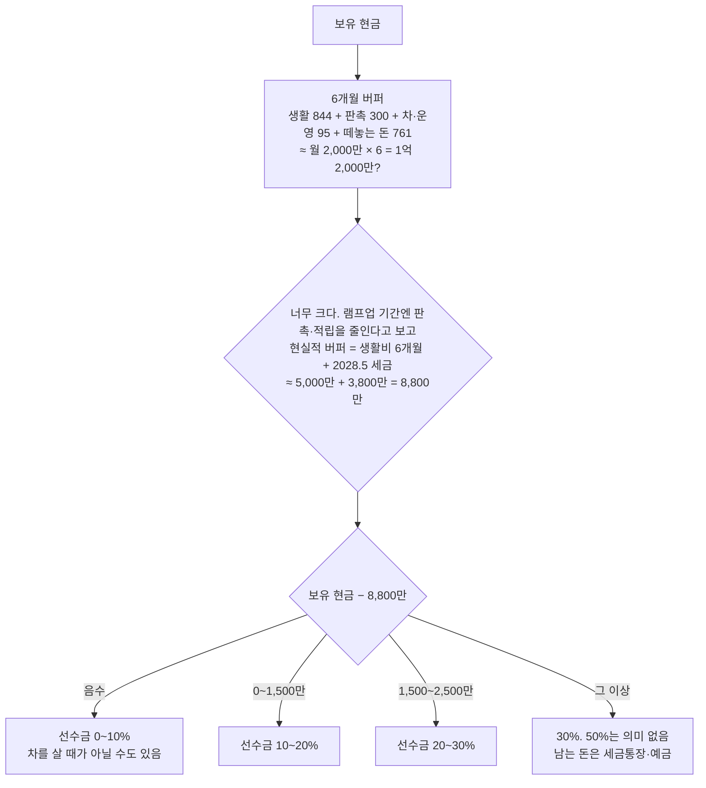

# 폴스타4 선수금 등급 — 얼마를 넣을 것인가

- 타임스탬프: 20261014_140041 UTC
- 유형: 분석
- 조건: 폴스타4 듀얼+옵션, 보조금·세제 후 실구매 7,580만. 60개월 5.9%. 한계부담률 43%, 업무비율 90%. 예금 세후 2.5% 가정.

## 1. 숫자

| 선수금 | 금액 | 월 납입 | 5년 총이자 | 이자 경비 효과 | 실질 이자 | 보유 1억일 때 남는 현금 |
|---:|---:|---:|---:|---:|---:|---:|
| 0% | 0 | 146만 | 1,191만 | −461만 | 730만 | 1억 |
| 10% | 758만 | 132만 | 1,072만 | −415만 | 657만 | 9,242만 |
| 20% | 1,516만 | 117만 | 953만 | −369만 | 584만 | 8,484만 |
| 30% | 2,274만 | 102만 | 834만 | −323만 | 511만 | 7,726만 |
| 50% | 3,790만 | 73만 | 596만 | −231만 | 365만 | 6,210만 |

## 2. 결론: 선수금은 돈 문제가 아니라 유동성 문제다

- 할부 이자는 경비다. 5.9% × (1 − 0.43 × 0.9) = **실질 3.6%**.
- 그 돈을 예금에 두면 세후 약 2.5%.
- 차이 1.1%p. **선수금 1,000만당 연 11만 절약.** 5년 50만. 결정을 바꿀 크기가 아니다.
- 반면 2028년 5월에 소득세 3,816만이 한 번에 나가고, 2027년 상반기는 매출 램프업 구간이다. 선수금으로 묶은 돈은 그때 못 쓴다.

## 3. 등급

| 등급 | 선수금 | 조건 | 이유 |
|---|---:|---|---|
| **S** | **20% (1,516만)** | 보유 현금 1억 이상 | 캐피탈 심사·금리 협상에 유리(신규 사업자는 소득증빙이 없어 0%는 거절·고금리 가능성). 유동성 8,500만 유지. 월 117만 |
| A | 10% (758만) | 보유 현금 7천~1억 | 심사 통과 최소선. 버퍼 우선 |
| A | 30% (2,274만) | 보유 현금 1억 2천 이상 | 월 102만으로 부담 체감 줄임. 그 이상 현금은 놀리는 게 아니라 세금통장 |
| B | 0% | 보유 현금 7천 미만 | 가능하면 좋지만, 신규 사업자 0% 할부는 승인·금리가 불리. 이 구간이면 2027년 하반기로 구매를 미루는 게 답 |
| C | 50% (3,790만) | — | 5년 실질 절약 365만, 대신 3,800만이 묶임. 2028.5 세금과 정면충돌. 하지 마라 |

## 4. 실무 포인트

1. **신규 사업자 할부 심사.** 2026년 11~12월 창업 직후엔 소득증빙(종소세 신고서)이 없다. 캐피탈은 신용점수·기존 대출·카드 사용액으로 본다. 근로소득 이력이 끝난 직후라면 2027년 5월 종소세 신고 전까진 승인 한도가 작을 수 있다. 선수금 20%는 이걸 뚫는 용도다.
2. **금리 견적 3곳.** 폴스타 파이낸셜(프로모션), 현대캐피탈/KB캐피탈, 주거래 은행 신용대출. 신용대출이 4%대면 할부보다 싸고 똑같이 이자 경비 처리된다(차량 구입 목적 입증 필요).
3. **잔가보장형·리스는 별개.** 잔가 설정 할부는 월 납입이 70~80만으로 떨어지지만 5년 뒤 잔가 2~3천만을 내거나 반납. 25만 km를 탈 사람은 주행거리 초과 정산이 커서 비추.
4. 선수금을 넣어도 **감가상각 기준은 차값 전체(7,580만)**다. 선수금 때문에 경비가 줄지 않는다.

## 5. 다음

- 보유 현금, 신용점수, 기존 대출 잔액 → 등급 확정.
- 캐피탈 견적 금리 → 5.9% 가정 교체.
