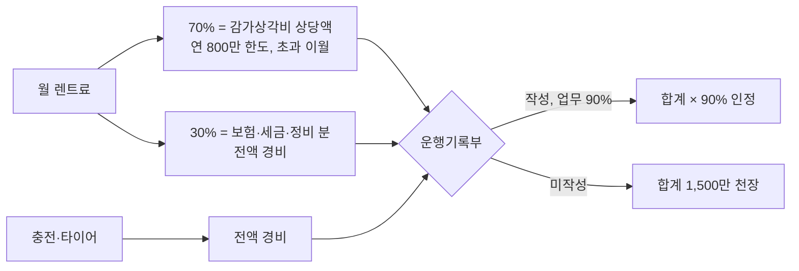

# 장기렌트 — 무제한 주행 옵션 업체, 개인사업자 세무 처리, 할부와 비교 기준

- 타임스탬프: 20261019_012157 UTC
- 유형: 조사
- 배경: 연 5만 km. 5년 25만 km면 잔존가치가 거의 0이라 그 리스크를 렌트사에 넘기는 발상은 맞다. 문제는 렌트사도 그걸 알고 가격에 넣는다는 것.

## 1. 업체별 확인 결과 (2026-10 검색 기준, 상담으로 재확인 필요)

| 업체 | 무제한 주행 | 수입차(폴스타) | 초과 요금 | 메모 |
|---|---|---|---|---|
| **KB캐피탈** | ○ (1만~4만 0.5만 단위 + 무제한) | **수입차는 약정 최대 3만 km.** 금융렌탈(만기 인수형)은 무제한만 선택 | — | 폴스타를 무제한으로 하려면 **금융렌탈(인수형)** 경로. 계약 후 약정거리 변경 불가 |
| **롯데렌터카** | 약정형(상담 시 무제한 가능 여부 확인) | ○ | **수입차 1km당 200원**, 국산 100원 | 수입차 2만 약정 + 연 5만 주행이면 초과 3만 km × 200원 = **연 600만** |
| **기아 장기렌트(직영)** | ○ 명시 | 기아만 | 약정 초과분 − 기본공제 2,000km, km당 100원 | 폴스타 불가. EV6·EV9 대안일 때 |
| SK렌터카 | 약정형, 무제한 상담 | ○ | 미확인 | 수입차 취급 큼 |
| 현대캐피탈 | 무제한 옵션 있다고 알려짐(미확인) | ○ | 미확인 | 상담 확인 |
| 하나·신한·삼성·우리금융·메리츠 캐피탈 | 업체별 상이 | ○ | 업체별 | 비교견적 앱(겟차·차픽·카모아)으로 한 번에 |

핵심: **수입차 + 연 5만 km 조합은 렌트사가 가장 싫어하는 고객**이다. 무제한이 아예 안 되거나(KB 3만 상한), 되더라도 월 렌트료에 잔존가치 손실을 다 얹는다.

## 2. 렌트가 할부보다 싸게 나오려면

할부(폴스타4 듀얼+옵션) 월 통장 유출 208만 = 원리금 146 + 충전·타이어·보험·정비·세금 62.
렌트료에는 보통 **보험·자동차세·정비 일부**가 포함되고 **충전·타이어는 별도**다. 그래서 비교는 이렇게:

| | 할부 | 렌트(무제한, 보증금 0, 60개월, 만기 반납) |
|---|---:|---|
| 원리금 / 렌트료 | 146만 | **견적 X** |
| 보험·세금·정비 | 16만 | 포함 |
| 충전·타이어 | 46만 | 46만 (동일) |
| 5년 뒤 | 25만 km 차 소유, 잔존 ~1,000만 | 반납, 잔존 리스크 0 |
| **손익분기** | | **X ≤ 약 180만이면 렌트가 낫다** (146 + 16 + 잔존 손실 상쇄 약 20만) |

X가 180만을 넘으면 할부. 폴스타4 듀얼 60개월 장기렌트 모의견적이 선납 30% 기준 약 72만(2만 km 약정)이라는 자료가 있다. 선납 0·무제한으로 바꾸면 130~170만 사이가 나올 가능성이 있고, 이게 180만 아래면 렌트가 이긴다. **견적 없이는 결론이 안 난다.**

## 3. 개인사업자 세무 처리 (렌트)

- 렌트료 × 70%가 감가상각비 상당액. 연 800만 한도 → **월 렌트료 95만까지는 전액 경비**, 그 이상은 70% 부분이 이월.
- 월 150만 렌트면: 70% 1,260만 → 800만 인정 + 460만 이월, 30% 540만 전액, 충전·타이어 550만 → 약 1,890만 × 90% = **1,700만 인정**. 할부(1,755만)와 거의 같다. **세금 면에서 렌트와 할부는 차이 없다.**
- 부가세: 렌트료의 10%도 승용차라 **매입세액 불공제**. 할부와 동일.
- 번호판 '하·허·호'. 거래처 방문 영업에서 신경 쓰이면 감점 요인.
- 2027년 간편장부 해는 한도 없음(할부와 동일 보너스).
- 신규 개인사업자 심사: 렌트사도 신용점수·소득증빙을 본다. 할부보다 심사가 느슨한 편이라 **2026년 12월~2027년 초 승인은 렌트가 더 쉬울 수 있다.** 이게 렌트의 실질 장점 하나.

## 4. 견적 요청 템플릿 (3곳 이상 동일 조건으로)

| 항목 | 조건 |
|---|---|
| 차종 | 폴스타4 롱레인지 듀얼 + 옵션 1,000만 (또는 폴스타3 듀얼) |
| 기간 | 60개월 (36개월도 병기) |
| 보증금/선납 | 0 |
| 약정 주행거리 | **무제한.** 불가하면 5만 km 또는 4만 km + km당 초과요금 명시 |
| 만기 | 반납 / 인수 둘 다 (인수가 포함) |
| 포함 | 보험(자차 자기부담금), 자동차세, 정비 범위, 대차 |
| 중도해지 | 위약금 % |
| 계약 주체 | 개인사업자 (사업자등록 후) |

## 5. 결론

- 렌트의 가치는 잔존가치 리스크 이전과 심사 용이성이다. 세금 차이는 없다.
- 수입차 무제한은 KB 금융렌탈(인수형) 또는 롯데·SK·현대캐피탈 상담으로 확인. 기아 직영은 무제한 명시이나 기아차만.
- 무제한·보증금 0·60개월 렌트료가 **월 180만 이하면 렌트, 넘으면 할부.**
