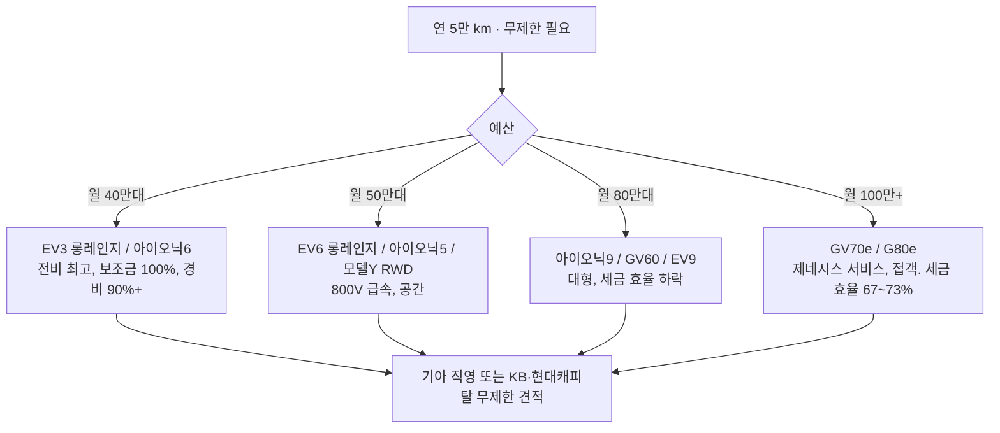

# 전기차 무제한 주행 렌트 — 어디서 되고, 어떤 차가 싸게 먹히나

- 타임스탬프: 20261019_061347 UTC
- 유형: 조사 + 분석
- 변경: `cso_plan.py` CAR에 국산 전기차 9종 추가(2026 추정가, 전비 추정)

## 1. 핵심: 무제한은 차종이 아니라 "누가 파느냐"다

| 판매 경로 | 무제한 | 수입차 | 확인 근거 |
|---|---|---|---|
| **기아 장기렌트(직영)** | ○ 공식 명시 | 기아만 | 약정 초과 시 km당 100원, 무제한 선택 시 제한 없음 |
| **렌트앤카 등 중개 플랫폼** | ○ 1만~4만·무제한 선택 | 모델Y 확인 | 복수 캐피탈·렌트사 연결 |
| **KB캐피탈** | ○ (국산). 금융렌탈(인수형)은 무제한만 | 수입차 약정 3만 상한 | 계약 후 변경 불가 |
| 롯데렌터카 / SK렌터카 / 현대캐피탈 | 상담 (국산은 가능성 높음) | 롯데 수입차 초과 200원/km | 공개 자료 없음 |
| 실제 무제한 계약 사례(승계 매물) | EV6 롱레인지 4WD 48개월 월 63만, 아이오닉5 롱레인지 월 93.5만, 모델Y(플랫폼 상품) | | 보증금·선납 조건 미공개 |

→ **국산 전기차는 거의 다 무제한이 된다.** 수입차는 모델Y가 플랫폼 경유로 되고, 폴스타·BMW·벤츠 전기차는 3만 상한이 일반적.

## 2. 무제한 후보 전기차 — 할부 시 월 부담 (입금 2,000만, 운행기록부 90%, 60개월 5.9%)

| 차종 | 차량가 | 보조금 | 실구매가 | 할부/월 | 충전/월 | 경비 인정률 | **스포티지 대비 월 부담** | 무제한 렌트 |
|---|---:|---|---:|---:|---:|---:|---:|---|
| **EV3 롱레인지** | 4,700만 | 100% | 3,870만 | 75만 | 20만 | 95% | **34만** | 기아 직영 ○ |
| **아이오닉6 롱레인지** | 5,200만 | 100% | 4,370만 | 84만 | 19만 | 91% | **42만** | 국산 ○ |
| **EV6 롱레인지** | 5,300만 | 50% | 4,470만 | 86만 | 21만 | 90% | **45만** | 기아 직영 ○, 사례 있음 |
| 아이오닉5 롱레인지 | 5,400만 | 50% | 4,720만 | 91만 | 22만 | 88% | 50만 | 국산 ○, 사례 있음 |
| 모델Y RWD | 5,700만 | 50% | 4,920만 | 95만 | 20만 | 86% | 52만 | 플랫폼 ○ |
| 아이오닉9 | 6,700만 | 50% | 6,020만 | 116만 | 26만 | 79% | 77만 | 국산 ○ |
| GV60 | 6,800만 | 50% | 6,120만 | 118만 | 23만 | 78% | 76만 | 국산 ○ |
| EV9 | 7,500만 | 50% | 6,820만 | 132만 | 27만 | 74% | 92만 | 기아 직영 ○ |
| GV70 전동화 | 7,700만 | 50% | 7,020만 | 135만 | 25만 | 73% | 94만 | 국산 ○ |
| G80 전동화 | 8,919만 | 0 | 8,389만 | 162만 | 24만 | 67% | 117만 | 국산 ○ |
| 폴스타4 듀얼 | 7,190만 | 50% | 6,510만 | 126만 | 26만 | 76% | 86만 | ✗ (3만 상한) |

경비 인정률 = 세무서가 경비로 봐주는 비율. 실구매가 4,000만 이하면 감가상각 800만 천장에 안 걸려 95%, 비싸질수록 떨어진다. **세금 효율은 싼 차가 압도적으로 좋다.**

## 3. 연 5만 km 영업차 관점에서 고른다면

- **세금·현금으로만 보면 EV3·아이오닉6**: 월 34~42만, 충전비 월 19~20만, 보조금 100%.
- **고속 장거리 + 급속 충전 빈도가 높으면 EV6·아이오닉5**(800V, 18분 충전). 월 45~50만.
- **접객·체면이 중요하면 GV60·GV70e**. 월 76~94만.
- G80e는 월 117만. 무제한 렌트가 되는 건 맞지만, 같은 돈이면 GV70e + 23만이 남는다.

## 4. 렌트 손익분기 (할부 대비, 무제한·보증금 0·60개월·보험 포함 기준)

| 차종 | 할부 원리금 + 보험·세금 + 잔존 상쇄 | **렌트료가 이 이하면 렌트** |
|---|---:|---:|
| EV3 | 75 + 14 + 5 | 약 95만 |
| 아이오닉6 / EV6 | 85 + 15 + 7 | 약 105만 |
| 아이오닉5 / 모델Y | 93 + 16 + 8 | 약 115만 |
| GV60 / 아이오닉9 | 117 + 17 + 12 | 약 145만 |
| EV9 / GV70e | 134 + 18 + 15 | 약 165만 |
| G80e | 162 + 18 + 7 | 약 185만 |

## 5. 가정·확인

- 차량가: 2026년형 국내 추정(EV3 롱레인지 4,700 / 아이오닉6 5,200 / EV6 5,300 / 아이오닉5 5,400 / 아이오닉9 6,700 / GV60 6,800 / EV9 7,500 / GV70e 7,700). 트림·옵션으로 ±500만. 각사 홈페이지 확인.
- 보조금: 5,300만 미만 100% 구간 약 300만(국고+지자체, 현대·기아 가산 포함 추정), 5,300~8,500 50% 약 150만.
- 전비: 인증값 근사. 타이어 110~150만/4만 km. 세제 감면 530만 공통.
- 무제한 렌트료는 전부 견적 필요. 승계 사례(EV6 63만, 아이오닉5 93.5만)는 보증금·선납 조건 불명.
