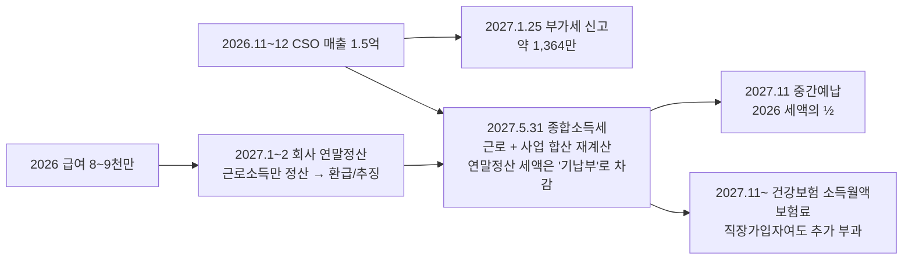

# 2026년에 근로소득(연봉 8~9천)과 연말 매출 1.5억이 겹치면 — 연말정산과 종합소득세의 관계

- 타임스탬프: 20261019_114749 UTC
- 유형: 분석
- 입력: 2026 원천징수영수증 기준 연봉 8,000~9,000만. 2026년 11~12월 CSO 매출 약 1.5억(부가세 포함 여부 미확인).

## 1. 연말정산은 별개가 아니다. "선정산"이다

- 회사는 2027년 1~2월에 **급여만** 가지고 연말정산을 한다. 거기서 환급이 나와도 끝이 아니다.
- 사업소득이 있는 해는 **2027년 5월에 근로+사업을 합쳐 종합소득세를 다시 신고**한다. 연말정산 때 낸 세금은 기납부세액으로 빼준다. 그래서 "연말정산은 1차, 5월이 최종".
- 근로소득 관련 공제(카드·보험료·의료비·근로소득세액공제)는 5월 합산 신고에서도 근로소득 부분에 그대로 적용된다. 사라지지 않는다.

## 2. 왜 세금이 커지나 — 사업소득이 급여 "위에" 얹힌다

연봉 8,500만이면 급여만의 과세표준이 약 6,000만(24% 구간). 사업소득 1.28억이 그 위에 올라가면 과세표준 1.9억 → **38% 구간**. 즉 연말 2개월 매출은 처음부터 24~38%로 과세된다. 2027년에 사업소득만 있을 때보다 불리하다.

## 3. 숫자 (경비 800만, 노란우산 200만, 카드공제 250만 가정)

| 연봉 | 1.5억 해석 | 공급가액 | 부가세 (2027.1.25) | 2026 사업소득 | 과세표준 | 구간 | 합산 소득세+지방세 | 회사 원천징수 | **2027.5 추가 납부** | 2027.11 중간예납 | 건보 추가 (월, 2027.11~2028.10) |
|---:|---|---:|---:|---:|---:|---|---:|---:|---:|---:|---:|
| 8,000만 | 부가세 포함 | 1억 3,636만 | 1,364만 | 1억 2,836만 | 1억 8,486만 | 38% | 5,498만 | 841만 | **4,657만** | 2,749만 | 73만 |
| 8,500만 | 부가세 포함 | 1억 3,636만 | 1,364만 | 1억 2,836만 | 1억 8,961만 | 38% | 5,696만 | 967만 | **4,729만** | 2,848만 | 73만 |
| 9,000만 | 부가세 포함 | 1억 3,636만 | 1,364만 | 1억 2,836만 | 1억 9,436만 | 38% | 5,894만 | 1,092만 | **4,802만** | 2,947만 | 73만 |
| 8,500만 | 공급가액 1.5억 | 1억 5,000만 | 1,500만 | 1억 4,200만 | 2억 324만 | 38% | 6,267만 | 967만 | **5,301만** | 3,134만 | 83만 |

**내야 할 돈 요약 (연봉 8,500·부가세 포함 기준)**

| 시점 | 항목 | 금액 |
|---|---|---:|
| 2027.1.25 | 부가세 (제약사가 얹어준 10%, 내 돈 아님) | 1,364만 |
| 2027.1~2 | 연말정산 | 급여분만, 평소와 비슷 |
| **2027.5.31** | **종합소득세 추가 납부** (사업소득 때문에 늘어난 분) | **4,729만** |
| 2027.11.30 | 중간예납 (2026 세액 ½ 선납) | 2,848만 |
| 2027.11~2028.10 | 건보 소득월액보험료 (보수 외 소득 2,000만 초과분) | 월 73만 × 12 = 876만 |

1.5억 매출에서 세금·보험으로 나가는 돈: 소득세 4,729 + 건보 876 = **약 5,600만, 매출의 41%**. 부가세 1,364만은 별도(패스스루).

## 4. 경비가 세금을 얼마나 줄이나 (2026년, 한계 41.8%)

| 2026년 사업 경비 | 2027.5 추가 납부 |
|---:|---:|
| 800만 (판촉 2개월) | 4,729만 |
| 3,000만 (판촉 + 운영비 + 노트북 등) | 3,807만 |
| 6,000만 (차량 구입 포함) | 2,513만 |

2026년은 신규사업자라 **간편장부**이고, 업무용승용차 800만·1,500만 천장이 **없다**. 2026년 12월에 차를 사면 2개월치 감가상각이 아니라 취득가 기준 상각분이 경비가 되고, 한계세율 41.8%가 적용된다. 2027년(간편장부 2년차, 한계 35%)보다 2026년 12월 구매가 절세 효과가 더 크다. 다만 세금 때문에 사지 말라는 원칙은 그대로.

## 5. 가장 큰 레버: 귀속 연도

소득세는 **용역 제공이 완료된 날**이 속한 연도에 귀속된다. 입금일이 아니다.

| 상황 | 귀속 | 세율 |
|---|---|---|
| 2026.12 판촉 완료, 12월 세금계산서 | 2026 | 급여 위에 얹혀 38% |
| 2026.12 판촉 완료, 2027.1 입금 | **2026** (완료일 기준) | 38% |
| 계약·판촉 활동이 2027.1부터 | 2027 | 2027년 소득만으로 과세. 급여가 없으면 6%부터 시작 |

2027년에 퇴사해 급여가 없다면, 같은 1.5억이 2027년 귀속이면 세금이 약 2,000만 줄어든다(과세표준이 0부터 쌓이니까). **계약서상 용역 기간과 세금계산서 발행 시점을 세무사와 반드시 상의.** 다만 이미 2026년에 일을 다 했으면 2027로 미루는 건 탈세다. 일이 실제로 언제 이뤄지느냐가 기준.

## 6. 기장·신고 방식

- 2026 신규사업자, 서비스업 매출 1.36억 ≥ 7,500만 → 단순경비율 불가. **간편장부 기장**으로 실제 경비를 넣거나, 기준경비율(사업지원서비스 약 15~20% 추정)로 추계. 경비가 적으면 기준경비율이 유리할 수도 있어 둘 다 계산.
- 복식부기로 신고하면 기장세액공제 20%(한도 100만).
- 제약사가 세금계산서 대신 3.3% 원천징수(사업소득 지급)로 처리하면 부가세는 없고 3.3%가 기납부세액이 된다. 어느 방식인지 계약서 확인.

## 7. 미확정

| 항목 | 영향 |
|---|---|
| 1.5억이 부가세 포함인가 | 추가 납부 4,729 vs 5,301 |
| 용역 완료 시점·세금계산서 발행 시점 | 2026 vs 2027 귀속. 최대 2,000만 |
| 2026년 사업 경비 규모 | 100만당 42만 |
| 2027년 퇴사 여부·시점 | 2027 세율 구조, 건보 지역/직장 |
| 연말정산 공제 항목(카드·보험·의료비·부양가족) | 수십~수백만 |
| 세금계산서 vs 3.3% 원천징수 | 부가세 1,364만 유무 |
